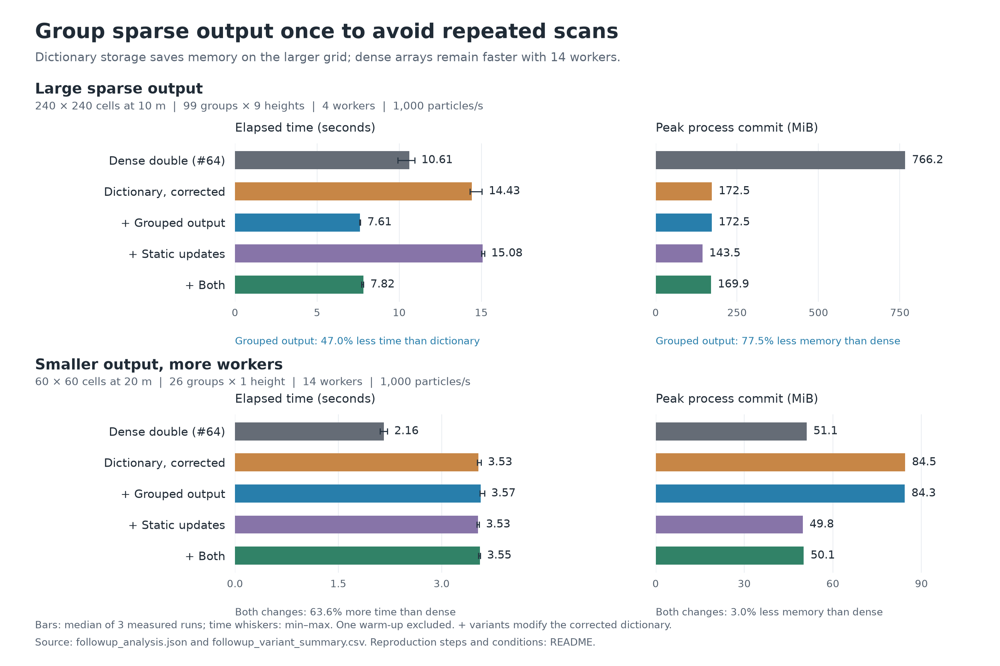

# GRAL #64: dictionary follow-up tests

For double-precision accumulation, an optional dictionary path is most useful when the full horizontal concentration array is large and only a small fraction of its cells are occupied. Arrays remain faster in the ordinary grids tested here. Grouping dictionary entries once for each output call removes repeated scans across source groups and output heights. Static update callbacks reduce temporary allocations, especially in smaller grids.

## Comparison and source

All variants use the same numerical implementation except for concentration storage and the small patches listed below. The dense reference applies only #64's precision change to the current common base. Sources are reconstructed from official commits and verified against file hashes before building.

| Variant | Source and change |
|---|---|
| `double` | `e3336e8e901d5f49f20fa3a954a08463517bf61d` plus `pr64_on_current.patch` |
| `dictionary_fixed` | Developer branch `7d4366a6ac16f58a5d28f166e272e59247362630` plus `dictionary_fixed.patch` |
| `output_index` | Corrected dictionary plus `output_index.patch`: one file, +33/-1 lines |
| `static_update` | Corrected dictionary plus `static_update.patch`: two files, +6/-6 lines |
| `combined` | Both independent changes on the corrected dictionary |

The correction patch removes an early dictionary clear that discarded residual contributions. It also restores the centre-cell condition in odour output and the receptor null guard, and removes two unused variables. The original developer branch remains available in the earlier comparison under `prior/`.

The output index groups occupied entries by output height and source group. It lasts for one output call and is released in `finally`. The particle drivers finish before the output thread starts, and the next accumulation waits for that thread. The lookup preserves the existing double-to-float conversion and cell assignment. Static `AddOrUpdate` callbacks receive the double increment as their argument, preserving the addition order within each update.

## Results

| Case | Double array | Corrected dictionary | Dictionary with both changes |
|---|---:|---:|---:|
| 240 × 240 cells, 99 groups, 9 heights, 4 workers | 10.61 s / 766 MiB | 14.43 s / 172 MiB | 7.82 s / 170 MiB |
| Same grid and groups, 1 height, 4 workers | 3.77 s / 172 MiB | 4.06 s / 138 MiB | 4.11 s / 105 MiB |
| 60 × 60 cells, 26 groups, 1 height, 14 workers | 2.16 s / 51 MiB | 3.53 s / 84 MiB | 3.55 s / 50 MiB |

For the large 99-group, 9-height case, the dictionary with both changes used 26.3% less time and 77.8% less peak process commit than the double array (median of paired changes). The output-only change was fastest at 7.61 s; adding static callbacks gave 7.82 s. Static callbacks alone reduced memory but did not improve speed. With 26 groups and 14 workers, the combined dictionary remained 63.6% slower than the array. At 8,000 particles/s it remained 17.3% slower. These results support an explicit storage option; source-group count or particle rate alone is insufficient for an automatic choice.

Peak process commit is the Windows `PeakPagefileUsage` counter, expressed in MiB. It is distinct from working set; both are available in the CSV. Time is whole-process elapsed time, including model setup and output. Each condition has one discarded warm-up and three measured runs in rotating variant order. Percentage changes are paired by repeat number; the figure also shows the full observed timing range.



The machine used a Ryzen 9 9950X3D, 48 GiB RAM, Windows and .NET SDK 10.0.401. Trials use 100, 500, 1,000 or 8,000 particles/s, with different grids, emission types, output heights, weather and worker limits. Each model process has a 120-second timeout and each batch an 840-second limit.

Final timing results come from `ablation_clean`, `extension` and `stress`. Earlier timings in `prior/` and `followup/results/ablation/` are retained as historical records and excluded from the final timing comparison because stale document-conversion processes were using CPU. Those processes were stopped before any measured run used in the final analysis. The output comparisons from the earlier runs remain useful.

## Numerical and output checks

The final analysis contains 148 model runs: 37 warm-ups and 111 measured runs across 11 conditions. All completed successfully. Measured steady-state comparisons were exact in 66/66 pairs, and measured one-worker transient comparisons in 6/6 pairs. In the four-worker transient case, the combined variant had maximum relative L1 5.970188567e-10 against the double array; the double array itself had the same maximum relative L1 across its measured repeats. Each build also matched 980 writer outputs covering odour, deposition, ASCII and compressed formats, including consecutive output calls, and passed 65 output-lifetime checks. Deposition coverage here comes from the writer tests; the new model matrix contains no deposition run.

The source-group limit is a separate change. In the earlier native boundary tests, 101 groups passed and 102 groups stopped in the existing input/statistics arrays. Integer dictionary keys alone do not remove the other array and stored-ID limits.

For integration, the output-index allocation should share the writer's existing error-reporting scope. The prototype allocates the lookup before that scope, as noted in the concurrency review. The output-cache lifetime tests also exercise cleanup after an odour calculation throws.

## Reproduce

Use a fresh copy of `followup/`, Git, .NET 10 and a working Python installation with NumPy. Matplotlib is needed only for the figure. In these commands, `python` stands for that interpreter. Restoration refuses to overwrite an existing build or restored source directory.

```text
cd followup
python work/benchmark/restore_followup.py --git git --dotnet dotnet
python work/benchmark/dictionary_suite.py --tag repeat_ablation_clean --cases sparse_sg99_fine9_t4 neutral_sg26_t14 --variants double dictionary_fixed output_index static_update combined --repeats 3
python work/benchmark/dictionary_suite.py --tag repeat_extension --cases neutral_sg26_t1 neutral_sg26_t4 sparse_sg99_fine1_t4 transient_three_t1 transient_three_t4 --variants double dictionary_fixed combined --repeats 3
python work/benchmark/dictionary_suite.py --tag repeat_stress --cases terrain_stable_area_t8 convective_mixed_t8 buildings_mixed_t4 medium_8000ps_t8 --variants double dictionary_fixed combined --repeats 3
python work/benchmark/writer_lifecycle_test.py --job . --stage all
python work/benchmark/analyze_followup.py --tags repeat_ablation_clean repeat_extension repeat_stress
python work/presentation/build_followup_figure.py --tag repeat_ablation_clean
```

Run batches sequentially with other CPU-intensive tasks stopped. The harness checks completion, source and particle counts, finite outputs, and nonzero residual-only output where applicable. The summary keeps concentration and deposition comparisons separate. Exact output hashes avoid redundant decoding; differing payloads are decoded and checked against the comparisons made during the runs.

`followup/results/followup_variant_summary.csv` contains every measured condition. `followup/results/followup_paired_summary.csv` contains paired percentage changes, and `followup/results/followup_numerical_summary.csv` contains numerical comparisons. The five source locks, four patches, synthetic inputs and reproduction code are included. Raw model outputs, runtime binaries and private research inputs are excluded. `PUBLIC_MANIFEST.json` records original and public-copy hashes separately for files whose local path metadata was removed.

A fresh restoration passed: all 410 source-file hashes matched, all five builds completed with zero warnings and errors, and five short transient model runs reproduced the original double-reference output payloads exactly. See `followup/qa/reproduction_check.json`.
