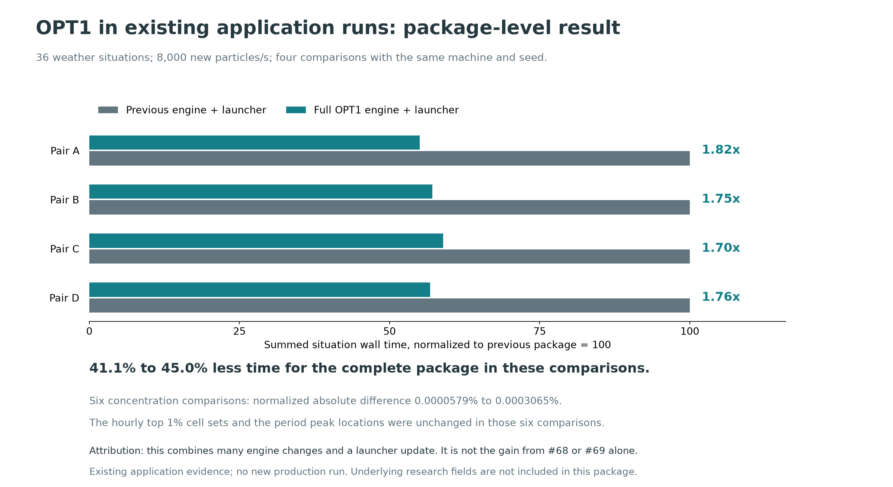
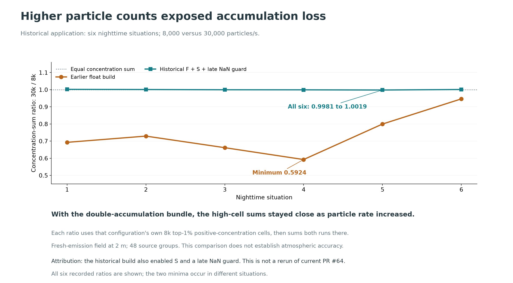

# Effects observed in existing application runs

These observations come from earlier application builds. They explain why the changes matter at a practical scale. The current PRs extract smaller changes from those builds, so a package-level result must not be read as an isolated measurement of one PR. The summaries below omit the research inputs and study-specific background.

## OPT1 package

At 8,000 new particles/s, the full OPT1 engine and updated launcher completed 36 weather situations 1.70 to 1.82 times faster than the preceding engine and launcher in four comparisons made on the same physical machine with the same seed. This corresponds to 41.1% to 45.0% less summed situation wall time.

Across six concentration comparisons, the normalized absolute difference was 0.0000579% to 0.0003065%. The hourly top 1% cell sets and period peak locations were unchanged. The difference metric sums area-weighted absolute differences over the assessed land cells and times, then divides by the reference concentration sum. This establishes close numerical agreement in those comparisons; it does not establish identical arrays or atmospheric accuracy.

The full package includes per-worker concentration buffering and other changes absent from #68 and #69. The historical vertical optimization also combined hinted search with repeated-height reuse, while #69 implements only reuse. The historical stack/slice change had a whole-model timing effect within run-to-run noise. The current PRs' component measurements therefore remain the evidence for their individual effects.

[Extracted measurements and source-file hash](plot_inputs/opt1_operational_context.json).

## Accumulation precision

An earlier application exposed the effect at higher particle counts. Across six nighttime situations, the ratio of 30,000-particle/s to 8,000-particle/s concentration sums in selected high-concentration cells fell as low as 0.5924 with the earlier float build. A historical build with double accumulation, source lookup and a late NaN guard kept all six ratios between 0.9981 and 1.0019. Each configuration used its own 8,000-particle/s hotspot cells. This supports the practical need to reduce accumulation loss; it is a historical bundle comparison, not a measured effect size for this PR alone.

For each situation, the analysis selected cells at or above the 99th percentile of positive concentrations in that configuration's 8,000-particle/s field. It then divided the 30,000-particle/s concentration sum by the 8,000-particle/s sum over the same selected cells. The comparison covers the 2 m fresh-emission field, 48 source groups and the same six nighttime weather situations. Values near one indicate reduced particle-rate sensitivity in this comparison, without establishing a true atmospheric concentration.

The historical implementation used a source-group buffer and different transfer plumbing. Current #64 uses double-array leaves. Both accumulate contributions in double precision before transfer, but the published historical effect size was not remeasured on current #64. [All six ratios, definitions and source hashes](plot_inputs/precision_operational_context.json).

## Non-finite states

Non-finite states were observed in an earlier application run: a guard placed just before concentration accumulation rejected ten particles across six situations at 2,000 particles/s. That log establishes that the condition occurs during actual tracking. It does not show ten corrupted output cells, and it does not measure the rejection counts of the earlier boundaries or storage checks proposed here.

The rejection counts by situation were 2, 1, 2, 2, 2 and 1. The paired control also had no stored NaN fields in this small test. These observations support adding boundary checks; they do not identify the physical branch that first generated each invalid state. [Recorded counts and source hashes](plot_inputs/nan_operational_context.json).
