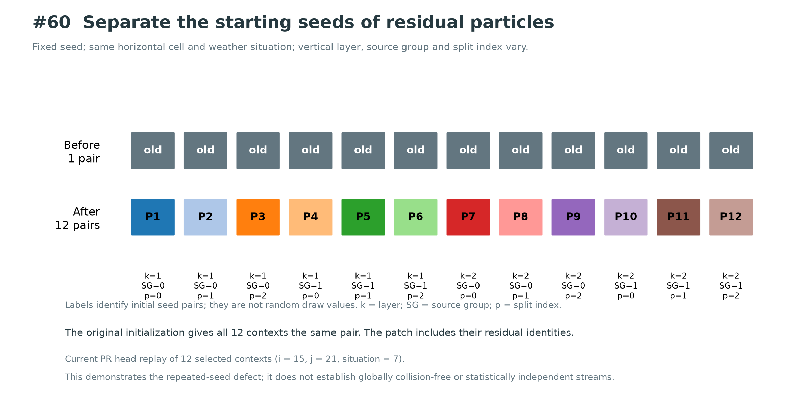
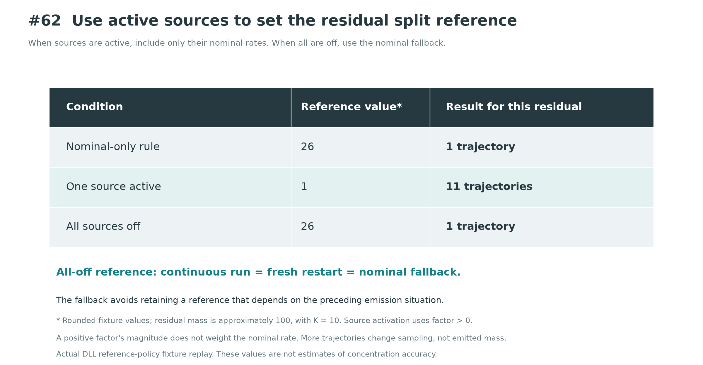
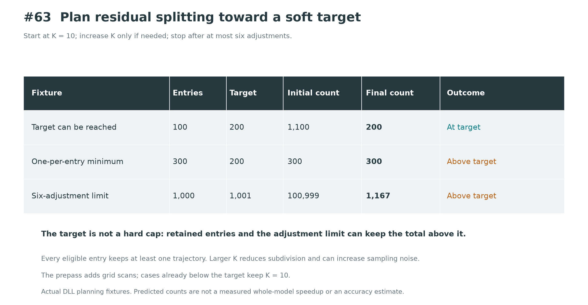

This package records the additional review of GRAL PRs #59 through #69 and a compatibility run comparing two local source compositions. The reference already contains #59 through #65; the candidate adds #66 through #69.

| Composition | Contents |
| --- | --- |
| `pr59_65_reference` | Fixed heads of #59 through #65 |
| `pr59_69_combined` | The reference plus the fixed heads of #66 through #69 |

The [source manifest](integration/source_manifest.json) lists all eleven public PR heads and the SHA-256 of each source file. Both compositions start from upstream commit `5f3983090053188de6b505900d45343ee8fec434`. They are review snapshots, not new commits on the individual PR branches.

The combined snapshot required two conflict resolutions: the non-finite mass check runs before `ResidualSplitCount(masse)`, and `Program.cs` retains both independent exchange-and-report blocks. [The final integration record](qa/integration_final.json) records those choices and supersedes the intermediate conflict records named in its history.

The new Main suite passed 32 runs and 536 checks. Both strict Release builds completed with zero warnings and errors. The six synthetic conditions produced 12 baseline/candidate comparison pairs, 12 same-variant repeat pairs and 200 compared payload pairs. Four resumed executions read checkpoints. The [Main summary](qa/main_validation_summary.json), [comparison table](qa/main_output_comparison.csv) and build logs record these results.

The comparison tests the effect of adding #66 through #69 to the #59 through #65 reference. It does not compare the combined snapshot directly with unmodified upstream. The earlier PR-specific suites remain separate evidence and are not added to the 32-run count.

The following component results are counted separately:

| Recorded component checks | Result and scope |
| --- | --- |
| Additional non-finite guards and optimization checks | 11,373 checks; parallel counters/storage, cache boundaries and actual stack-buffer entry paths |
| Residual seed checks | 38 checks through the compiled helper |
| Residual reference and adaptive splitting | 10 checks for #62 and 62 for #63; the latter includes a 210,000-case boundary sweep |
| Horizontal accumulation, F | 120 checks rerun from the previously built fixture |
| Source lookup, S | 991,352 checks, including 743,036 searches and 24 start-coordinate state pairs, rerun from the previously built fixture |

The additional non-finite and optimization fixture calls compiled methods. It does not inject faults into Main or complete particle tracking at the stack-buffer boundary sizes. F and S reruns use the earlier fixture binaries after matching 85 source files per topic to the current public PR heads. Their original source and reproduction packages remain available in the [F evidence](https://github.com/Borealis-Thoon/GRAL/tree/d7a0432e1be2439497759fda20628dc20c3dd650/evidence/review-20261012/F) and [S evidence](https://github.com/Borealis-Thoon/GRAL/tree/23eff94194d543e1a02fd86deec80685a3a046b3/evidence/patchS-review-20261012).

The figures show the recorded seed, reference and adaptive-target examples:







To reproduce the source compositions, use Git, a verified Python executable and the .NET 10 SDK. Run these commands from the evidence-package root. Replace `python` and `dotnet` with absolute executable paths if they are not available under those names.

```text
python -X utf8 -B reproduce/prepare_sources.py --work-root ../gral-review-recheck --include-components
```

The preparation script downloads the pinned public upstream commit, applies each portable patch and checks all 85 source-file hashes per composition. It normalizes patch input to LF, then restores the reviewed snapshot's line endings only when the resulting bytes match its recorded SHA-256. The public-fetch reconstruction was executed successfully for this package; its receipt is [source_reconstruction.json](qa/source_reconstruction.json). The optional component sources come from the pinned public fork heads.

Run the same Main comparison in a new output directory:

```text
python -X utf8 -B reproduce/run_integration_main.py --package-root ../gral-review-recheck/package --scope-file integration/inputs/scope.json --variants pr59_69_combined --run-dir ../gral-review-recheck/main --dotnet dotnet --execute
```

The wrapper sets the reference to `pr59_65_reference` and uses the same Main harness and synthetic input generator as the recorded run. The packaged harness adds executable-name resolution for portability. It retains the source-scope checks, strict builds, owned-process cleanup and 15-minute overall limit.

The additional component fixtures can be rebuilt and run separately:

```text
python -X utf8 -B reproduce/run_components.py --package-root ../gral-review-recheck/package --run-dir ../gral-review-recheck/components --dotnet dotnet
```

This command rebuilds the pinned sources for #59, #60, #62, #63 and #66 through #69, then runs the seed, reference/splitting and additional non-finite/optimization fixtures. It does not rerun the separate F and S packages. The packaged wrapper was syntax-checked; the recorded component results came from the original commands before packaging.

The Main results cover fixed-seed, one-worker synthetic cases. Each weather situation integrates for 30 seconds; hourly labels index the input series. Terrain and prescribed winds are synthetic, and the cases are not a factorial sensitivity study or a GRAMM validation. Checkpoint comparisons require reference/candidate equality after resumption; they do not establish equality between a continuous run and its restarted run. These synthetic tests have no physical concentration reference and do not measure production-scale performance or peak memory. The separately summarized [existing application results](OPERATIONAL_CONTEXT.md) describe historical builds and their attribution limits.

Raw model outputs, checkpoints, DLLs and research inputs are excluded. The package contains synthetic inputs, public-source patches, reproduction code, recorded checks and selected performance/error summaries from existing application runs. Private machine paths in metadata are replaced with `${REVIEW_ROOT}`, `${PRIOR_JOBS}` and `${USER_HOME}`; the private records retain the original paths. These placeholders document provenance and are not executable paths.

To redraw the five figures, install Matplotlib in your chosen Python environment and run `python plot_review_figures.py`. Use `--output PATH` to write them to a separate directory. The JSON inputs contain the plotted measurements and their definitions.
