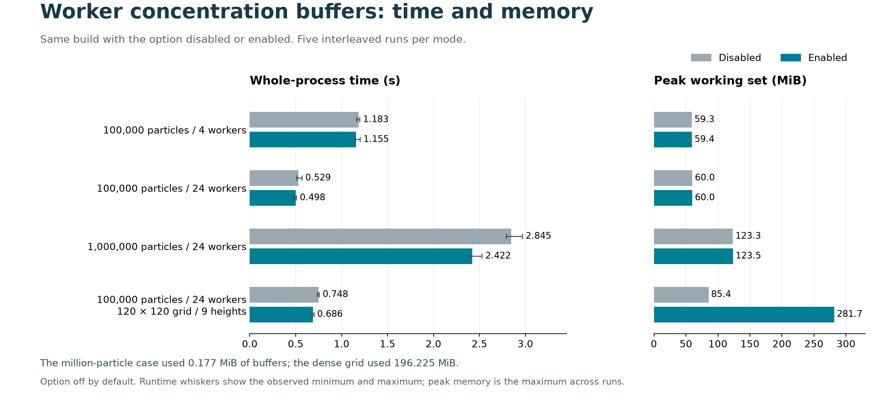

# Review of concentration transfer and worker buffers

This follow-up checks two interactions that deserved a closer look: the size cutoff in #71 and the use of #73 worker buffers with the small-particle progress fix in #74. The submitted implementation code is unchanged.

## Transfer cutoff

The compiled private transfer method ran in 32 separate processes: four array shapes, four or 24 workers, two builds and two process repetitions. Each process warms the method and records 15 batches of five transfers; its summary omits the first two batches. The shapes include 129,024 values below the cutoff, 131,072 values at the cutoff, four long columns, and a single source group spread over many columns. Each run checks exact float casts and zeroed double accumulators, including signed zero, NaN and infinity.

The three shapes using parallel transfer took 40.2% to 84.6% less time in the recorded medians. The serial shape below the cutoff took an additional 4.6 to 5.9 microseconds, consistent with the small serial-path differences in the original measurement. These measurements support retaining the current cutoff on this host. Individual batches are in `results/transfer_boundary.json`; `results/transfer_summary.csv` reports the medians across the two process repetitions.

## Worker buffers and small particle counts

The actual #73 queue, progress checks, buffer preparation and merge run with the #74 interval guard. A diagnostic visit-and-sum hook replaces the particle physics body so that the test can check exact dispatch coverage. All 120 runs passed: counts 1 through 10, one/four/24 workers, buffers off/on, and two repetitions. Every requested particle index was visited once, existing field values were retained, group sums matched and the selected buffer path was correct. Both diagnostic projects built with warnings treated as errors and zero warnings or errors.

The uninstrumented engine and numerical-output checks remain in the original #73 and #74 evidence packages. This follow-up checks their driver interaction.

## Figure



The figure uses the already published #73 measurements. It compares the same candidate with buffers disabled and enabled, and places runtime beside peak working set. This makes the runtime benefit and dense-grid memory cost easier to compare. `worker_buffers_review_data.json` contains the plotted values and their source link; `render_worker_buffers_review.py` regenerates PNG and SVG files with Matplotlib.

## Reproduce

Requirements: Git, Python 3.12 or newer, and the .NET 10 SDK. Use a checkout containing the three commits listed in `reproduce.py`, and choose a work directory that does not exist yet.

```text
python reproduce.py --repo PATH_TO_GRAL_CHECKOUT --work NEW_WORK_DIRECTORY
```

A fresh run of this public script passed all 120 driver and 32 transfer executions, with five strict builds and zero warnings or errors. Its execution receipt is in `results/portable_reproduction.json`; the original timing records remain separate.

The script reads the checkout through `git archive`, builds separate copies with warnings treated as errors, applies the one-line #74 guard to #73 and runs the two fixtures. `GRAL_DOTNET` can select a dotnet executable. The suite has a four-minute limit and individual subprocess timeouts. Raw model outputs and execution binaries are not included.
