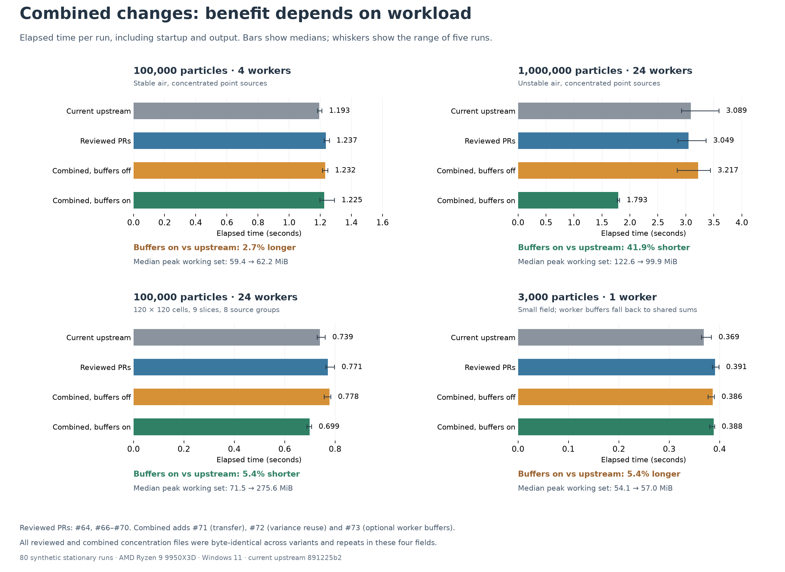

# Combined GRAL changes on four synthetic fields

The combined build reduced median elapsed time from 3.089 to 1.793 seconds in the one-million-particle, 24-worker concentrated case when worker buffers were enabled. The other cases show why the setting remains optional: the wide output grid used substantially more memory, and the small cases did not become faster than current upstream.



The comparison uses upstream `891225b2f9dbbcda7f5ef6e9ef6db65e64845108`. Each field was run five times with each of four configurations, for 80 Main runs:

| Configuration | Included changes |
|---|---|
| Current upstream | The upstream commit above, which already contains #59, #60, #61 and #65 |
| Reviewed PRs | Upstream plus [#64](https://github.com/GralDispersionModel/GRAL/pull/64), [#66](https://github.com/GralDispersionModel/GRAL/pull/66), [#67](https://github.com/GralDispersionModel/GRAL/pull/67), [#68](https://github.com/GralDispersionModel/GRAL/pull/68), [#69](https://github.com/GralDispersionModel/GRAL/pull/69) and [#70](https://github.com/GralDispersionModel/GRAL/pull/70) |
| Combined, buffers off | Reviewed PRs plus [#71](https://github.com/GralDispersionModel/GRAL/pull/71), [#72](https://github.com/GralDispersionModel/GRAL/pull/72) and [#73](https://github.com/GralDispersionModel/GRAL/pull/73), with the buffer setting unset |
| Combined, buffers on | The same combined executable with `GRAL_WORKER_CONCENTRATION_MB=256` |

PRs #62 and #63 are excluded because the residual splitting policy is still under discussion. All four fields here are stationary and use fixed particle seeds. The one-worker case takes the shared-accumulation fallback even when the buffer setting is present.

## Elapsed time and memory

These are cold-process times, including initialization, JIT and output. The order rotates between repeats and fields. Full ranges and both ratios of medians and medians of paired ratios are in [timing.csv](results/timing.csv) and [summary.csv](results/summary.csv).

| Field | Current, s | Reviewed, s | Combined off, s | Combined on, s | Combined on vs current |
|---|---:|---:|---:|---:|---:|
| 100,000 particles, 4 workers, stable air, concentrated point sources | 1.193 | 1.237 | 1.232 | 1.225 | 2.67% longer |
| 1,000,000 particles, 24 workers, unstable air, concentrated point sources | 3.089 | 3.049 | 3.217 | 1.793 | 41.94% shorter |
| 100,000 particles, 24 workers, 120 × 120 output cells, 9 slices, 8 groups | 0.739 | 0.771 | 0.778 | 0.699 | 5.44% shorter |
| 3,000 particles, 1 worker, small field | 0.369 | 0.391 | 0.386 | 0.388 | 5.41% longer |

Without worker buffers, the combined build was 3.25–5.17% slower than current upstream in these four cases. Enabling buffers shortened the large concentrated run consistently: all five paired ratios to current upstream were between 0.494 and 0.617. The wide-grid improvement was smaller and cost memory. Its median peak working set rose from 71.46 MiB in current upstream and 85.47 MiB with the reviewed PRs to 275.60 MiB with buffers enabled. The buffer payload itself was 196.2246 MiB, within the requested 256 MiB limit. The memory limit covers the buffer payload; whole-process memory also includes the rest of the engine.

The three additions address different work. #72 reuses the unstable-air variance calculation while its inputs stay unchanged. #73 lets each particle worker accumulate into its own double array and then merges the arrays, reducing shared-lock contention when many particles visit the same cells. #71 spreads a sufficiently large final double-to-float transfer across the existing workers. The ON/OFF comparison uses the same combined executable, so it directly measures the effect of enabling worker buffers in that combined build. The difference between current upstream and the combined build includes all listed PRs and cannot be assigned to one of them.

## Output checks

All 80 runs finished normally. Output member counts, grid dimensions, particle allocations and source counts matched the generated inputs. All concentration values were finite and nonnegative. No non-finite-state rejection was reported in these normal inputs. Three source variants built with warnings treated as errors, with zero warnings and zero errors.

For each field, every concentration member from the reviewed build, combined OFF and combined ON had the same SHA-256 hash across all five repeats. Thus the three new optimizations preserved the reviewed output byte for byte in these tests. The 120 comparisons between configurations and 160 pairs of repeated runs are retained in the CSV files.

The reviewed output differs from current upstream, which still accumulates horizontal concentrations in float. Across the five one-million-particle comparisons, the largest relative cell L1 difference was 0.33328%, and the largest relative change in the sum of concentration cells was 0.27229%. Those values describe the reviewed PRs together; this integration test does not isolate the contribution of #64. The cell-sum diagnostic includes every cell, slice and selected group. Current upstream also showed small differences between parallel repeats, while all reviewed and combined repeats matched exactly in these fields.

The linked PR evidence also covers transient operation, non-finite-state rejection, buffer-budget fallbacks and the affected numerical kernels.

## Reproduction

The recorded environment was Windows 11, an AMD Ryzen 9 9950X3D with 16 cores and 32 logical processors, .NET SDK 10.0.401 and Python 3.12.14. The test runner uses NumPy and Windows process-memory counters. Matplotlib is needed only to redraw the figure. Engine timing ran in an exclusive computation window and took about 104 seconds for the full 80-run sequence on this host.

Use a local clone of the public GRAL repository that contains commit `891225b2f9dbbcda7f5ef6e9ef6db65e64845108`. From this evidence directory, run:

```powershell
python prepare.py --repo D:\path\to\GRAL
python benchmark.py --run-name reproduced --repeat 5
python plot.py
```

`plot.py` redraws the recorded figure from `results/summary.json`; new measurements remain under the selected run name.

`prepare.py` applies the included topic patches and checks all 265 normalized source-file hashes. Its manifest records the limited context adjustments needed where independent patches meet. `benchmark.py` rebuilds all three executables with warnings as errors, creates the four synthetic fields, and writes results under the selected run name. Use `--dotnet` to select a different .NET executable. The default Main time cap is 900 seconds; individual processes are also capped. A capped or failed run is retained for inspection and is not reported as a passing suite.

The supplied `inputs/` folders are the exact generated inputs used for the recorded results. [source_manifest.json](source_manifest.json) fixes the source revisions and patch order. [audit.json](results/audit.json) records source equivalence against the three final topic commits and verifies output hashes. [summary.json](results/summary.json) contains every recorded time, memory observation and numerical comparison. No research-domain input, raw model output, checkpoint or executable is included.

[Review decisions for the other candidates](remaining_changes_decisions.md) record the changes already covered upstream and those set aside after testing.
