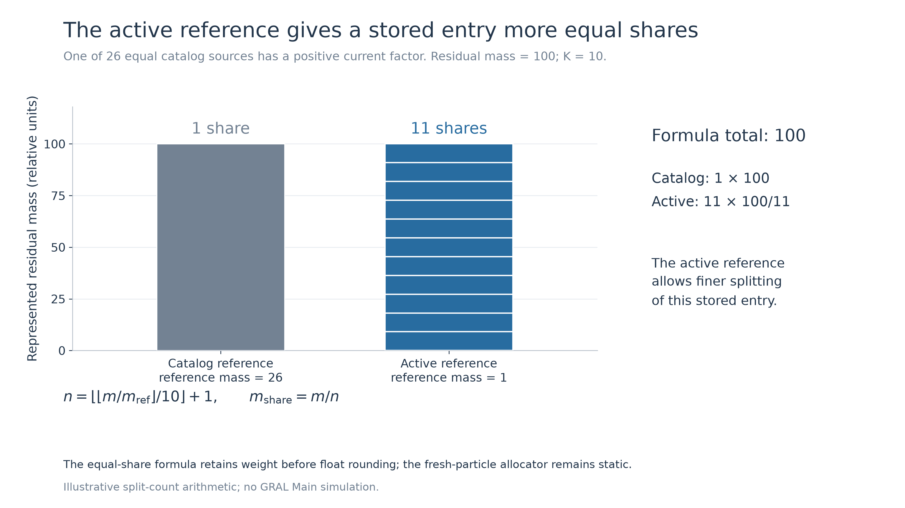
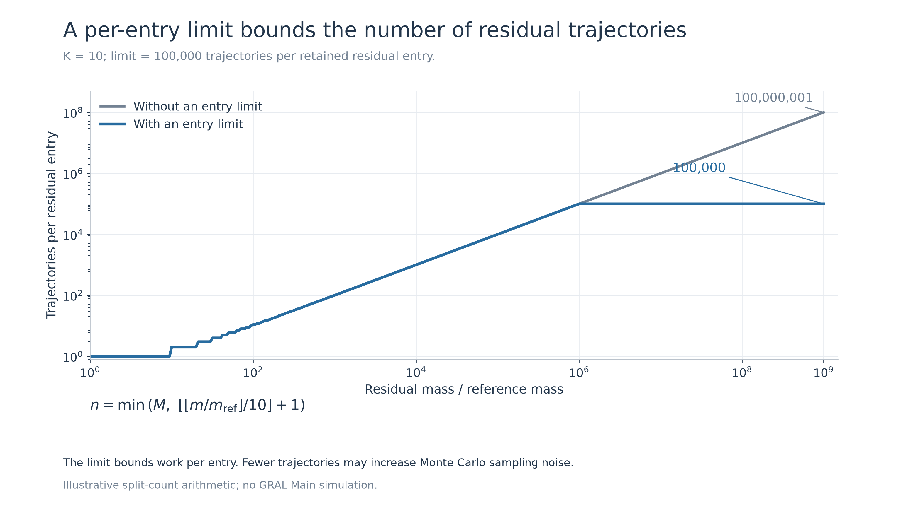
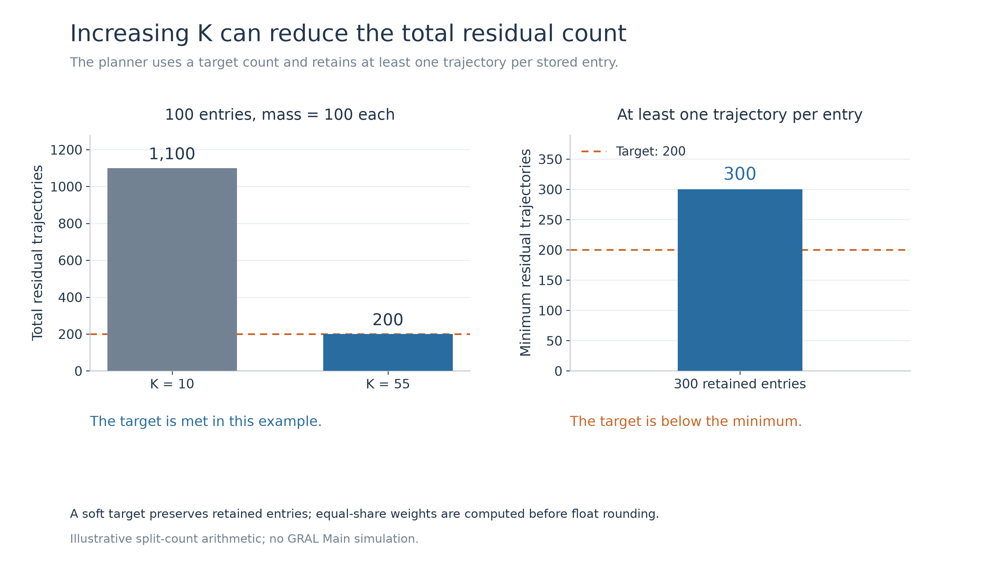
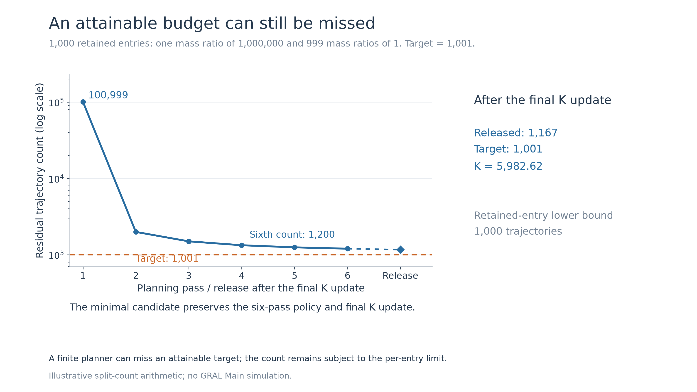
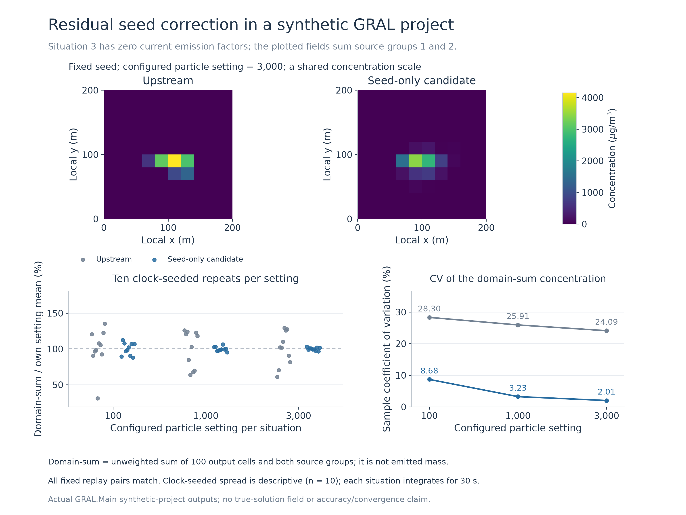

# Residual-particle review evidence

These files accompany five small GRAL changes based on V2701 commit `5f3983090053188de6b505900d45343ee8fec434`: unused-local cleanup, residual seeds, the split conversion limit, an active-source reference, and a soft total-particle target.

The source changes are separate from these test fixtures and figures. 

| Checkout folder | Branch | Commit |
|---|---|---|
| `warning_free_baseline` | `codex/residual-warning-cleanup-20261012` | [`3cfbd25505c2`](https://github.com/Borealis-Thoon/GRAL/commit/3cfbd25505c21034673d2c850c368e953d08ef7e) |
| `seed_only` | `codex/residual-context-seeds-20261012` | [`a63176745a12`](https://github.com/Borealis-Thoon/GRAL/commit/a63176745a12189f8f30e5625cdfe207cae30e98) |
| `C1_standalone` | `codex/residual-split-bound-20261012` | [`ea82dfac6a86`](https://github.com/Borealis-Thoon/GRAL/commit/ea82dfac6a862564f92e97a2a6564b2b698ec71d) |
| `C1_safe_split_limit` | `codex/residual-foundation-20261012` | [`33a92f911009`](https://github.com/Borealis-Thoon/GRAL/commit/33a92f9110096a5236bb74bc6290db2b3f6429ef) |
| `C2_active_reference` | `codex/residual-active-reference-20261012` | [`dbb695d3307d`](https://github.com/Borealis-Thoon/GRAL/commit/dbb695d3307da3bba045c78b74a5a1ce61e26f48) |
| `C3_adaptive_budget` | `codex/residual-adaptive-target-20261012` | [`11d92401953d`](https://github.com/Borealis-Thoon/GRAL/commit/11d92401953d982078045fcb8cea041ee819201b) |

## Fresh validation

Six GRAL candidates and three helper fixtures passed Release builds with `TreatWarningsAsErrors`: zero warnings and zero errors. The environment used .NET SDK 10.0.401 and runtime 10.0.12.

The actual GRAL Main executable completed 28 fixed-seed projects on a flat 200 × 200 m field with a 20 m grid, one worker, and three 30-second situations. Configured particle budgets were 100, 1,000, and 3,000. These are per-situation budgets, not a count of all fresh and residual particles over the whole test.

All 168 concentration payloads and 28 checkpoints matched the applicable reference outputs. The suite passed 252 project checks and 71 compiled checks: 38 seed checks, 22 split/reference checks, and 11 planner runtime checks. The split guard had no ordinary threshold differences in 210,000 sampled cases. The complete fresh suite took 26.07 seconds.

The 11 runtime checks exercise the extracted planner with test-only row witnesses. They confirm a configured worker limit of one and cancellation before and during traversal. The cancellation guard in Main was verified by source review; the full-project runs exercised normal execution.

## Figures and limits

The six PNG/SVG figures show arithmetic examples or the earlier 112-project synthetic study. That study included 90 clock-seeded runs, with ten repeats per tested budget and variant. The fresh validation above did not repeat those clock-seeded runs; their dispersion measures are descriptive sample results.

The seed fixtures test repeated streams and sampled contexts. The project comparisons test repeatability and regression behavior. Neither provides a true concentration solution or a general accuracy estimate.

The active-source reference treats positive temporal factors as activity flags and retains its last positive value in memory. That value is absent from checkpoints, so continuous and restarted all-off runs can differ. The planner's total target is soft, and its product-denominator arithmetic can change floating-point thresholds relative to the preceding nested-floor calculation.

Download [reproduce.zip](reproduce.zip) and unpack it. Prepare the six source checkouts in `../checkouts` using the names and commit SHAs in the source map above. From the unpacked archive directory, run:

```text
python reproduce/revalidate.py --source-root ../checkouts --run-dir ../residual_test_run --dotnet dotnet
```

Add `--check-only` to verify the package and source manifests without running the project tests. The runner also accepts an explicit `--source-map` JSON file.







