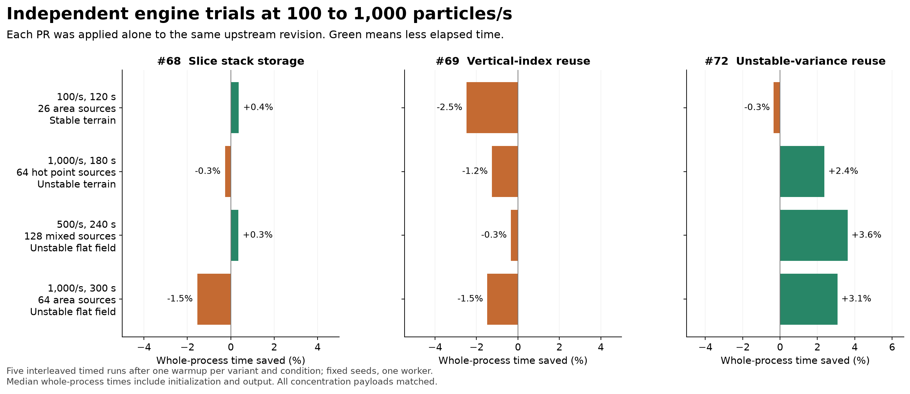
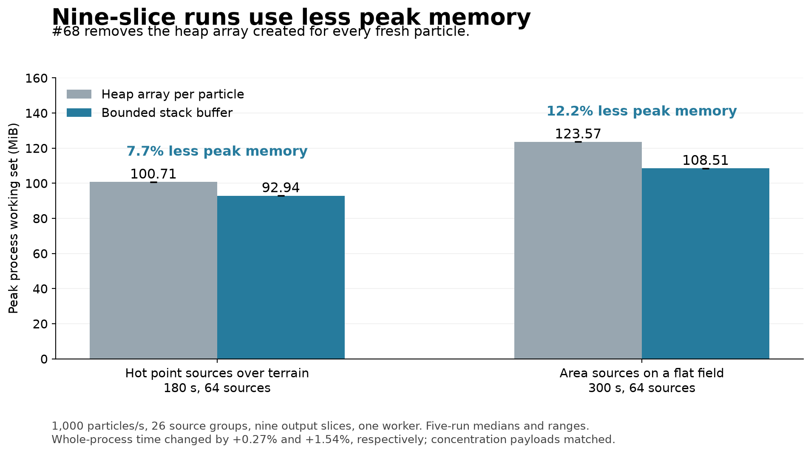
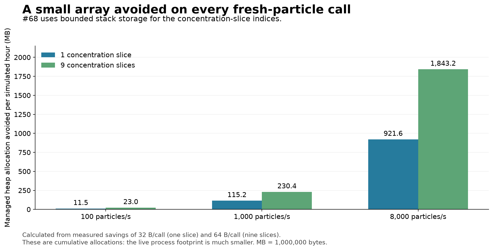

# Independent engine trials at practical particle rates

These trials compare the original engine with three separate changes: stack storage for slice indices (#68), repeated vertical-index reuse (#69), and reuse of unstable vertical-velocity variance (#72). Each patch is applied alone to V2701 `891225b2f9dbbcda7f5ef6e9ef6db65e64845108`. This separates the effect of each change from the other open PRs.

## Results

| Condition | Configured particles/s | Duration (s) | Sources | Flow/output grid (m) | Slices | Actual total particles | Original (s) | #68 (s) | #69 (s) | #72 (s) |
| --- | ---: | ---: | ---: | --- | ---: | ---: | ---: | ---: | ---: | ---: |
| Stable terrain, area sources | 100 | 120 | 26 | 20/20 | 1 | 12,012 | 0.851 | 0.848 | 0.872 | 0.854 |
| Unstable terrain, hot point sources | 1,000 | 180 | 64 | 20/10 | 9 | 179,968 | 5.111 | 5.124 | 5.175 | 4.989 |
| Unstable flat field, mixed sources | 500 | 240 | 128 | 40/20 | 1 | 119,968 | 1.571 | 1.565 | 1.576 | 1.514 |
| Unstable flat field, area sources | 1,000 | 300 | 64 | 20/10 | 9 | 300,032 | 5.565 | 5.651 | 5.647 | 5.394 |

Times are whole-process medians from five interleaved timed repetitions after one warmup per variant and condition. The domain was 1,200 m wide for the terrain cases and 1,600 m for the flat cases; all used 26 source groups and one worker. Stable terrain used 0.5 m/s and stability class 6. Hot points and mixed sources used 2.5 m/s and class 2; the flat area-source case used 1 m/s and class 2. Actual totals reflect the engine's source-allocation rounding. The CSV records both the configured rate and the actual total divided by duration.

All 96 engine executions completed, with byte-identical concentration payloads between variants and repetitions. All concentrations were finite and nonnegative. Four strict Release builds produced zero warnings and errors.



The two terrain cases targeted by #69 changed elapsed time by +2.48% and +1.25%. The additional bookkeeping has not demonstrated an engine-level benefit, so #69 is recommended for closure. #72 reduced elapsed time in the three unstable conditions by 2.38%, 3.63%, 3.08%. #68 changed the four medians by -0.37%, +0.27%, -0.35%, +1.54%; its value is removing a small heap allocation from every fresh-particle call.

## Allocation estimates for #68

The two nine-slice cases also reduced measured peak working set in every paired run. Their before/after ranges did not overlap. The single-slice cases stayed near 67 MiB.

| Condition | Original peak working set (MiB) | #68 peak working set (MiB) |
| --- | ---: | ---: |
| Stable terrain, area sources | 66.77 | 66.95 |
| Unstable terrain, hot point sources | 100.71 | 92.94 |
| Unstable flat field, mixed sources | 67.73 | 67.79 |
| Unstable flat field, area sources | 123.57 | 108.51 |



The earlier compiled-driver test measured 32 bytes per call for one slice and 64 bytes for nine slices, both reduced to zero by the stack-buffer path. The figure converts those measured per-call savings to 100, 1,000 and 8,000 fresh-particle calls per second over one simulated hour. It shows cumulative allocation avoided, not a reduction in peak resident memory. [Original allocation measurements](https://github.com/Borealis-Thoon/GRAL/blob/d696b6d787632bf14a3b01bea3da83b6d5dae9f8/opt1_review_v2/README.md) include the 512/513 fallback boundary.



## Reproduce

Use Windows, .NET 10 and Python with NumPy. Supply a GRAL clone containing the baseline commit and a new work directory:

```text
python prepare_hotloops.py --repo <GRAL-clone> --work-dir <new-work-dir>
python run_hotloops.py --work-dir <new-work-dir> --qa-dir <results> --dotnet <dotnet-executable>
python plot_hotloops.py --results <results>/hotloop_review.json --out-dir <figures>
```

The runner verifies source hashes before building, uses a 60-second per-process timeout and a 12-minute suite watchdog, and checks every decoded concentration payload. The synthetic terrain inputs prescribe a wind field; the input recipe, patches, build logs and measurements are included. Generated model output and executables are excluded.
