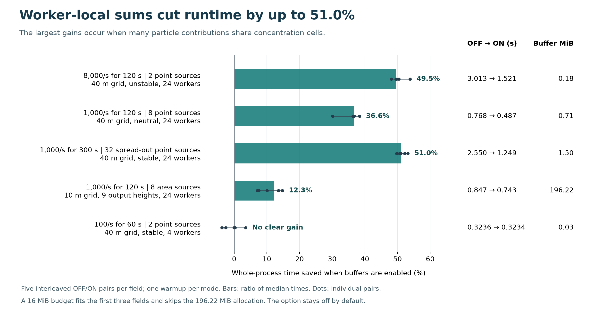
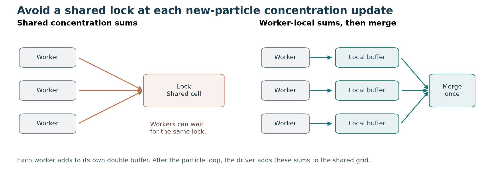

# Worker-local concentration sums at practical release rates

The fixed-seed driver currently locks shared concentration cells for each new-particle update. Giving each worker its own double buffer reduces contention, then the driver merges those buffers after the particle loop. The option stays off by default.

The comparison isolates #73 on top of #64 and V2701 commit `891225b2f9dbbcda7f5ef6e9ef6db65e64845108`. It contains no other performance patch. `source_manifest.json` records the patch hashes and all 177 source hashes across the two builds. The independent reconstruction check passed, and both Release builds completed with zero warnings and errors using `TreatWarningsAsErrors=true`.



At 1,000 particles/s, eight point sources over 120 simulated seconds took 0.768 s with shared sums and 0.487 s with buffers, a 36.6% reduction. Extending the simulation to 300 seconds and distributing 32 sources across the domain gave a 51.0% reduction, from 2.550 to 1.249 s. An unstable case at 8,000 particles/s took 3.013 s with shared sums and 1.521 s with buffers, a 49.5% reduction. These three conditions improved in all five matched pairs and required 0.18 to 1.50 MiB of buffer elements.

The 100 particles/s case had no clear gain. The finer grid with nine output heights saved 12.3% at a buffer cost of 196.22 MiB. A 16 MiB budget fits the three cases with the largest gains and makes the dense-grid case fall back to shared sums. The fallback check records the required storage, zero reserved buffer bytes and matching concentration payloads.

| Field | Total particles/s | Simulated duration | Sources / groups | Domain | Concentration grid | Heights | Wind / stability | Workers |
|---|---:|---:|---:|---|---:|---:|---|---:|
| Tutorial scale | 100 | 60 s | 2 / 2 | 800 m square | 40 m | 1 | 0.25 m/s / stable (6) | 4 |
| Eight point sources | 1,000 | 120 s | 8 / 8 | 800 m square | 40 m | 1 | 0.5 m/s / neutral (4) | 24 |
| Concentrated unstable | 8,000 | 120 s | 2 / 2 | 800 m square | 40 m | 1 | 0.25 m/s / unstable (2) | 24 |
| Longer, distributed sources | 1,000 | 300 s | 32 / 8 | 1,200 m square | 40 m | 1 | 1.0 m/s / stable (6) | 24 |
| Fine grid, nine heights | 1,000 | 120 s | 8 / 8 | 1,200 m square | 10 m | 9 | 1.0 m/s / neutral (4) | 24 |

Each field has one warmup for each mode, five timed OFF/ON pairs, and three timed runs of the separate #64-only build. Run order rotates between repetitions. The resulting 80 whole-process runs contain 65 timed runs and 15 warmups. The engine log confirms every requested particle and source count. All concentration outputs are finite and nonnegative; every repeated and paired payload is identical. The simulation duration and particle rate are separate input fields. The total allocations are 6,000, 120,000, 960,000, 300,000 and 120,000 particles respectively.

Disabled-mode medians ranged from 1.6% faster to 3.2% slower than the #64-only reference, with overlapping time ranges in most fields. `summary.json` retains all runs, including warmups, source counts, concentration hashes, process CPU time and Windows memory measurements. `measurements.csv` provides the smaller table used in the figure. The dots show individual paired time savings; the bars use the ratio of median times.



To reproduce on Windows with Git, .NET 10 and a Python environment containing NumPy:

```powershell
python reconstruct.py --repo C:\path\to\GRAL
python benchmark.py --build-only
python benchmark.py --run-name main
python check_budget.py
```

The local Git repository must contain the recorded V2701 commit. The reconstruction script verifies every source hash before writing the two source trees. The benchmark uses a 720-second suite watchdog and a 90-second per-run timeout. It runs engines sequentially. `check_budget.py` performs one warmup and five further runs of the dense-grid input with a 16 MiB budget.

To redraw the figures with Matplotlib, point `--root` to this directory and `--public` to an output directory:

```powershell
python present.py --root . --public redraw
```

The input fields are synthetic. This package contains input files, source patches, scripts and validation records; model outputs and compiled binaries stay outside the publication.
