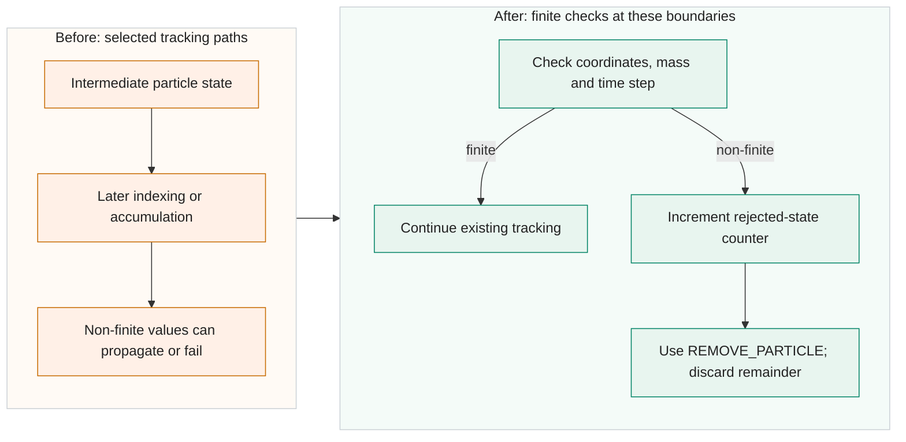

<!-- Title: Reject non-finite particle states at tracking boundaries -->

`Zeitschleife.Calculate()` and the residual `ParticleDriver()` derive grid indices and concentration contributions from the particle coordinates, mass and time step. On the selected paths, an intermediate NaN or infinity can reach later indexing or accumulation without a finite-state check. The early transient-expiry path can also store a state before the normal tracking loop checks it. Invalid remainder data can then affect subsequent residual tracking or shared fields.

Add `Program.ParticleStateIsFinite()` in `ProgramFunctions.cs` and call it at the selected boundaries in both drivers. It checks x/y, z, concentration-related mass and time step. The residual initializer also checks its initial real mass, and the unsplit transient-entry calculation rejects a non-finite mass before deriving a split count. The checks after decay and wet-loss clamping screen their resulting mass values. A failed tracked state follows the existing `REMOVE_PARTICLE` path. Contributions that were valid before the rejection, including receptor contributions, remain; the untracked remainder is discarded without zero replacement, redistribution or replay.

`NonFiniteParticleCount` is a long counter incremented with `Interlocked`. One rejected state or unsplit transient entry is counted when it first fails a checked boundary; this is not the number of originally emitted particles. `Program.cs` exchanges and resets the counter and reports nonzero values after particle tracking finishes for the weather situation. The separate residual-write guard uses its own counter and is not part of this PR.

The shared NaNGuard component suite passed 1917 checks. Relevant state evidence includes 20 actual initial-driver cases and extracted production-branch checks. In the extracted expiry tests, none of 16 injected candidate fault cases reached storage, and 40 normal pairs matched. These are selected branch tests, not full Main fault injection or a measured real-run failure rate.

The Main suite ran 120 projects across the baseline and both NaNGuard variants. This candidate accounts for 40: 36 normal runs and four checkpoint prefix/resume runs. Its 36 normal baseline comparisons and two resumed-output comparisons matched, with no rejection report in normal runs. All three suite variants passed strict Release builds with zero warnings and errors. The controlled runs use fixed seeds, one worker and actual allocations of 100, 1000 or 3000 particles. A separate suite of the baseline and all four patches together passed 80 runs and 1264 checks, with all 380 compared payload pairs matching.

Existing global-value, domain and index preconditions remain. Finite zero, negative values and subnormals remain accepted. RNG endpoint arithmetic and ignored Clamp return values are unchanged; already polluted arrays or checkpoints are not healed, and previous contributions are not rolled back. No atmospheric-accuracy or full-model speedup claim is made.

The change adds 118 lines in four files, with 4528 added source-body characters, including indentation and excluding all CR/LF characters. The full comparison to V2701 includes the shared PR #59 cleanup and has 121 added and three removed lines in four files (4992 source-body characters under the same definition). It targets V2701 with the [warning cleanup in PR #59](https://github.com/GralDispersionModel/GRAL/pull/59) as a prerequisite. The [state-only comparison](https://github.com/Borealis-Thoon/GRAL/compare/3cfbd25505c21034673d2c850c368e953d08ef7e...47c8f8f84c2c3c855523459e189e731c8c42bd3a) excludes that cleanup. Public evidence links will be added after approval of the separate evidence bundle.

- [x] AI-assisted code and automated review.
- [ ] Author has reviewed every changed line and confirmed its correctness.
- [x] Local Release build with `TreatWarningsAsErrors=true`: zero warnings and errors.
- [x] No new nullable-reference warnings.
