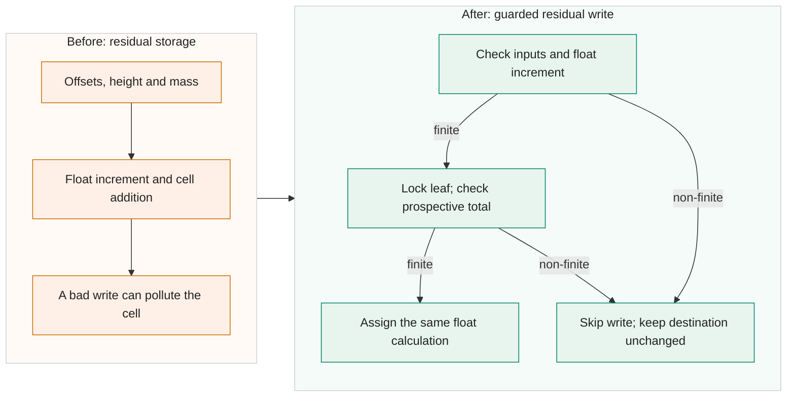

<!-- Title: Guard residual concentration writes against non-finite values -->

`TransientConcentration.Conz5dZeitschleife()` and `Conz5dZeitschleifeTransient()` convert offsets and relative height to residual-grid indices, compute a float increment, and add it to `Conz5d`. A non-finite coordinate or mass can reach those operations. Even with finite inputs, conversion to float or addition to a large float cell can overflow. One bad write can therefore make a residual cell non-finite and carry that value into later weather situations.

In `Transient_Concentration.cs`, check x/y offsets, `zcoord_nteil - AHint` and the mass argument before indexing. Check the computed float increment before entering the existing leaf-array lock. Inside that lock, compute the prospective float total and assign it only if it is finite. A rejected call returns without changing the destination. The valid calculation, float precision, locking and storage layout remain; the existing mass-to-concentration formula remains in use.

`NonFiniteResidualWriteCount` is a separate long counter, incremented once per rejected storage call. It is not a count of particle states or originally emitted particles. `Program.cs` reports and resets nonzero counts after particle tracking finishes for the weather situation. The rejected remainder is not replaced, redistributed or replayed, and earlier valid contributions stay in place.

The actual-DLL storage tests cover 32 injected fault cases across the two methods and 56 normal cases. All 32 candidate fault calls left the destination unchanged and counted the rejected write; normal results matched the baseline. In those selected baseline cases, 12 writes produced non-finite storage, eight calls threw indexing exceptions, and 12 calls wrote finite values to unintended cells. The shared component suite passed 1917 checks, including these storage tests and separate state/branch tests; 1917 is not a storage-only count. Parallel storage and counter checks include one and two workers.

The Main suite ran 120 projects across the baseline and both NaNGuard variants. This storage candidate accounts for 40: 36 normal runs and four checkpoint prefix/resume runs. Its 36 normal baseline comparisons and two resumed-output comparisons matched, and normal runs produced no skipped-write report. All three suite variants passed strict Release builds with zero warnings and errors. These are controlled fixed-seed, one-worker runs with 100, 1000 or 3000 particles; they do not inject faults into a complete Main run. A separate suite of the baseline and all four patches together passed 80 runs and 1264 checks, with all 380 compared payload pairs matching.

A finite-input requirement still leaves the existing domain, cell-size and source-index preconditions in place. If a destination is already NaN or infinity, rejecting a new addition preserves that polluted value rather than healing it. Other shared concentration, receptor and deposition sums are outside this patch. No mass-balance repair, checkpoint recovery or atmospheric-accuracy improvement is claimed.

The change has 52 added and four removed lines in two files, totalling 2998 added-plus-removed source-body characters, including indentation and excluding all CR/LF characters. The full comparison to V2701 includes the shared PR #59 cleanup and has 55 added and seven removed lines in four files (3462 source-body characters under the same definition). It targets V2701 with the [warning cleanup in PR #59](https://github.com/GralDispersionModel/GRAL/pull/59) as a prerequisite. The [storage-only comparison](https://github.com/Borealis-Thoon/GRAL/compare/3cfbd25505c21034673d2c850c368e953d08ef7e...5a333595fea7a7956956db20c712f32213b1a2e7) excludes that cleanup. Public evidence links will be added after approval of the separate evidence bundle.

- [x] AI-assisted code and automated review.
- [ ] Author has reviewed every changed line and confirmed its correctness.
- [x] Local Release build with `TreatWarningsAsErrors=true`: zero warnings and errors.
- [x] No new nullable-reference warnings.
