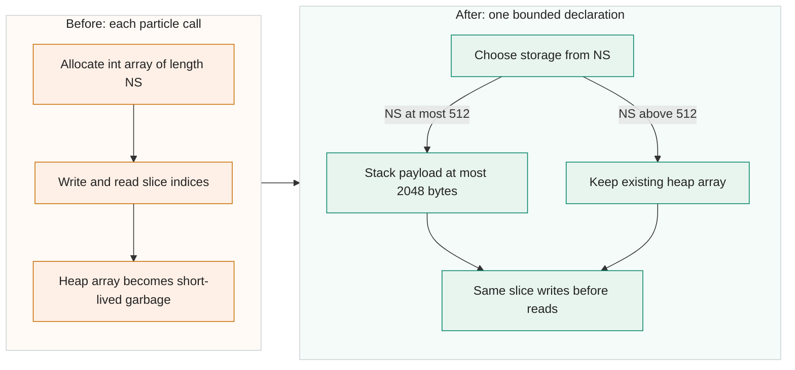

<!-- Title: Use bounded stack storage for particle slice indices -->

`Zeitschleife.Calculate()` creates `Span<int> kko = new int[Program.NS]` for each newly emitted particle. `kko` holds the concentration-slice indices, so even a small slice count creates a heap array on every call. With many particle calls, those short-lived arrays add allocation and garbage-collection work.

Replace that one declaration in `Zeitschleife.cs` with bounded stack storage for valid `NS <= 512`, retaining the existing heap allocation above 512. The kko buffer therefore uses at most 2048 bytes of stack payload. This bound applies only to kko, not the method's total stack use. The source audit checked that every kko read follows its slice-index write; stack storage does not depend on the array's previous zero initialization. Slice calculations, tracking logic and RNG call order remain unchanged.

The allocation benchmark calls the actual production method and then exits through the initial out-of-domain removal path. Its measured heap allocation per call was:

| NS | Baseline bytes | Candidate bytes |
|---:|---:|---:|
| 1 | 32 | 0 |
| 9 | 64 | 0 |
| 512 | 2072 | 0 |
| 513 | 2080 | 2080 |

Each condition used 4096 calls. These measurements isolate entry allocation and early exit; they do not time full particle tracking or establish a full-model speedup. The large-NS fallback preserves allocation size, while the extra branch can still have a timing cost. Four component entry checks cover these declaration boundaries; they are not full NS=512/513 Main runs.

This stack candidate passed 40 actual Main executions: 36 normal runs and four checkpoint prefix/resume runs. Its 36 normal baseline comparisons and two resumed-output comparisons matched in controlled fixed-seed, one-worker cases with actual allocations of 100, 1000 or 3000 particles. The recorded shared OPT1 suite has 120 runs across the baseline, stack candidate and the vertical-search candidate; 120 is not a stack-only count. All three variants passed strict Release builds with zero warnings and errors. Normal full-tracking regression and the source audit support read-before-write correctness separately from the early-exit allocation test. A separate suite of the baseline and all four patches together passed 80 runs and 1264 checks, with all 380 compared payload pairs matching.

No allocation result is presented as atmospheric accuracy or production throughput. Timing can affect TickCount-based seeds and multithreaded arrival order even when RNG calls and scheduling code stay unchanged. This one-line patch is independent of the separate vertical-search optimisation and the NaNGuard proposals.

The edit replaces one line in one file. Added and removed source bodies total 145 characters, including indentation and excluding all CR/LF characters; the LF unified diff contains 583 characters. The full comparison to V2701 includes the shared PR #59 cleanup and has four added and four removed lines in two files (609 source-body characters under the same definition). It targets V2701 with the [warning cleanup in PR #59](https://github.com/GralDispersionModel/GRAL/pull/59) as a prerequisite. The [stack-only comparison](https://github.com/Borealis-Thoon/GRAL/compare/3cfbd25505c21034673d2c850c368e953d08ef7e...b4ffec5e2ab55d3ec3717ed37d04938837e00120) excludes that cleanup. Public evidence links will be added after approval of the separate evidence bundle.

- [x] AI-assisted code and automated review.
- [ ] Author has reviewed every changed line and confirmed its correctness.
- [x] Local Release build with `TreatWarningsAsErrors=true`: zero warnings and errors.
- [x] No new nullable-reference warnings.
