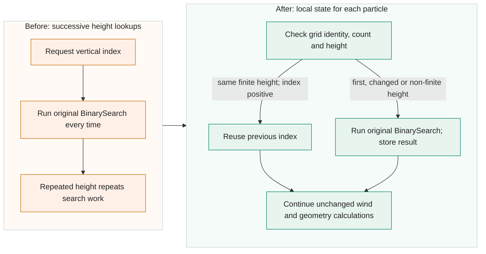

<!-- Title: Reuse the vertical index for repeated finite heights -->

The terrain branch of `Zeitschleife.IntWindCalculate()` and the building/terrain checks in both particle drivers call `BinarySearch()` to locate the particle's height in `Program.HOKART`. Successive calls can use exactly the same adjusted height. With the vertical grid fixed during tracking, they repeat a search whose result cannot change. Repeated lookups add search work without changing the selected layer.

Keep one local `WindSearch` value in each particle driver and pass it by reference to the internal interpolation and search overloads in `Intwind.cs`. It stores the grid reference, `NKK`, last height and returned index. Both drivers initialize this state only for `Consts.TerrainAvailable`; otherwise the default state keeps the existing search. The first query calls the original search. A later query reuses its positive index only for the same finite height; every changed or non-finite height calls the original `BinarySearch()`. A changed grid reference or `NKK` resets the state. The state is a local struct and holds a reference to the existing grid. Reuse requires equal finite heights, even when two different heights would return the same layer. The original public six-argument `IntWindCalculate()` remains and delegates with a default state, so its search stays uncached. Wind arithmetic and RNG calls remain unchanged.

Performance depends on the lookup sequence. The actual-DLL benchmark includes a fresh state for each synthetic particle and reports medians from seven rounds. Across 45 conditions, all 15 repeated-height conditions were 1.735 to 5.408 times faster. Of the 30 changed-height conditions, 29 took 4.326% to 28.135% longer and one was 1.051 times faster. The bookkeeping can therefore cost more than it saves when heights keep changing.

A separate 18-condition benchmark used synthetic sequences with exactly 50% consecutive repeated heights, including state preparation. All conditions were 1.148 to 1.585 times faster, with 36 checksum comparisons matching. These sequences were not a replay of actual Main heights. Test-only counters in four candidate runs of two synthetic terrain projects recorded 444724 hits from 889446 calls, about 50%, with `NKK=39`; four baseline runs gave 146 matching payload pairs. Those counters support use of the path in these projects but alter timing. Neither the lookup benchmarks nor the hit counts establish a whole-model speedup or a production hit-rate distribution.

The shared OPT1 component suite passed 1593341 checks across 35 profiles, including four separate stack-entry checks. The search and interpolation cases compare the actual compiled DLLs, including repeated heights, boundary values, signed zero and non-finite queries, plus grid-reference and count invalidation. In-place profile changes were tested with a fresh particle state. The contract is an immutable `HOKART` within one particle; arbitrary in-place edits while its state is live are not detected. The published LF build passed these component checks again and matched the measured build's compiled code across all 646 methods.

This vertical candidate passed 40 Main executions: 36 normal runs and four checkpoint prefix/resume runs. Its 36 normal baseline comparisons and two resumed-output comparisons matched in controlled fixed-seed, one-worker cases with actual allocations of 100, 1000 or 3000 particles. The shared final OPT1 suite contains 120 runs across the baseline, stack and vertical variants, and all three strict Release builds passed with zero warnings and errors. A separate suite of the baseline and all four patches together passed 80 runs and 1264 checks, with all 380 compared payload pairs matching. The equality checks do not guarantee clock-seeded or multiworker shared-sum results, and this patch makes no atmospheric-accuracy claim.

The topic changes three files with 55 added and eight removed lines: 3762 added-plus-removed source-body characters, including indentation and excluding all CR/LF characters. The full comparison to V2701 includes the shared PR #59 cleanup and has 58 added and 11 removed lines in three files (4226 source-body characters under the same definition). It targets V2701 with the [warning cleanup in PR #59](https://github.com/GralDispersionModel/GRAL/pull/59) as a prerequisite. The [vertical-only comparison](https://github.com/Borealis-Thoon/GRAL/compare/3cfbd25505c21034673d2c850c368e953d08ef7e...7c23fe92803a019c1535af7f02fcc6b2e940f2ee) excludes that cleanup. Public evidence links will be added after approval of the separate evidence bundle.

- [x] AI-assisted code and automated review.
- [ ] Author has reviewed every changed line and confirmed its correctness.
- [x] Local Release build with `TreatWarningsAsErrors=true`: zero warnings and errors.
- [x] No new nullable-reference warnings.
