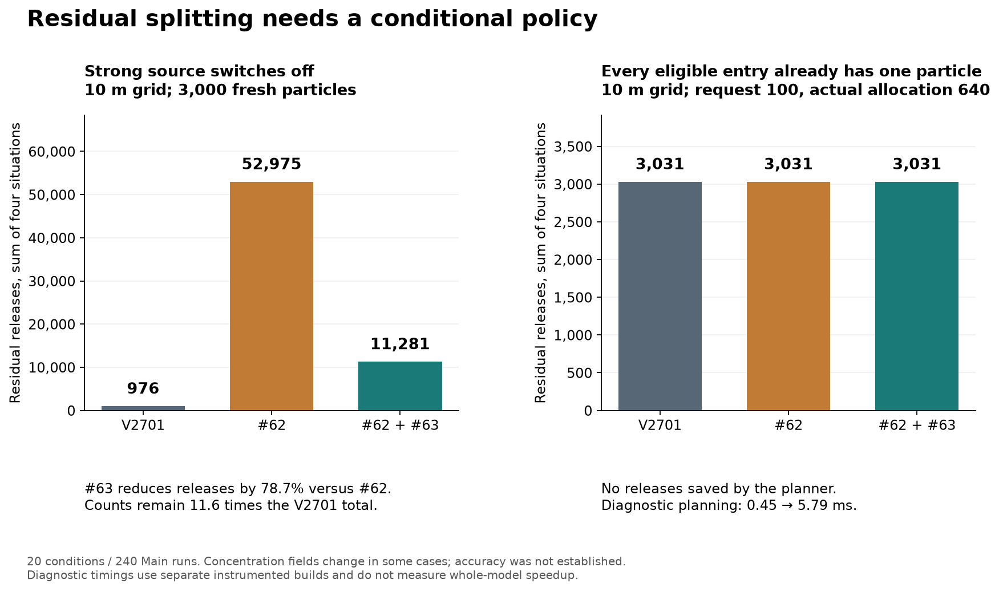
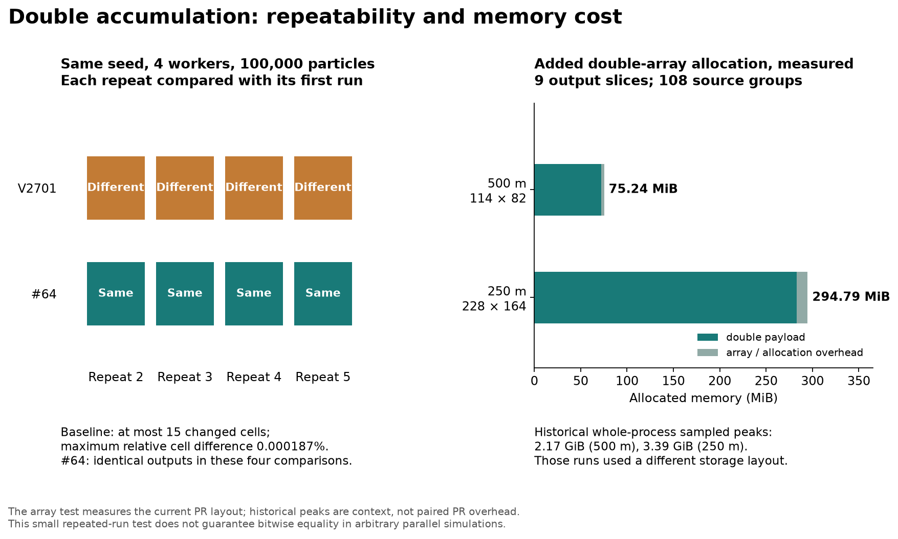
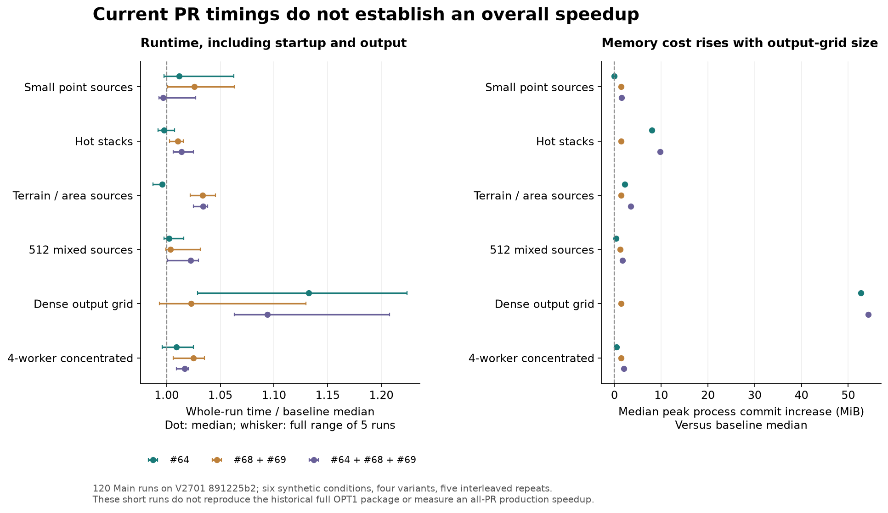

# Follow-up evidence for the residual and precision PRs

These checks respond to the maintainer's questions on GRAL #63 (including #62) and #64. The engine baseline is V2701 at `891225b2f9dbbcda7f5ef6e9ef6db65e64845108`, which already contains #59, #60, #61 and #65. The current PR implementations were tested without modification.

- [Residual policy tests](residual/README.md): 20 conditions, 240 Main runs, six strict builds. The results support retaining the current default and evaluating a conditional policy separately. They include a source-switching case with a large change in residual releases, and a case where repeated planning cannot reduce the one-particle-per-entry floor.
- [Precision and optimization tests](f_opt/README.md): six conditions, 120 Main runs, four engine builds and one component build. These measure repeat variation, process memory and runtime for #64, #68+#69 and their combination. The component fixture adds four allocation shapes and 72 accumulation-order cases.
- [Verified 108-group application runs](application_runs/README.md): the hardware, completion and output-index audit supporting the consumer-PC example.
- [Application context](application_context.json): aggregate measurements from historical application runs, including grid size, particle allocation, source records and memory. The historical engine has a different storage layout and includes changes beyond the current PRs. These records provide motivation and scale, not isolated current-PR effects.

The new runtime tests do not establish that #68 and #69 offset #64's cost. The residual concentration changes have no independent accuracy reference. The repeated-run comparison shows removal of a small observed rounding variation; it does not guarantee bitwise equality in every parallel simulation.

The two subdirectories contain separate reproduction instructions and source hashes. Their timings come from sequential executions, with diagnostic runs kept separate. Figures can be regenerated with Python and Matplotlib by running `make_figures.py` from this directory. No research inputs, raw concentration arrays, checkpoints or executable binaries are included.
