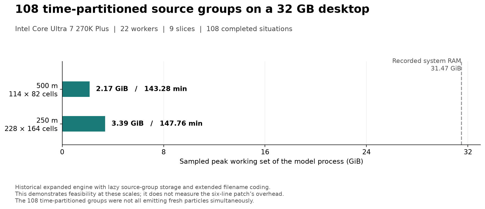

# Source-group indexing review

This patch fixes six array-bound expressions in the GRAL engine at `891225b2f9dbbcda7f5ef6e9ef6db65e64845108`. It covers the existing positive byte-sized source-group IDs, 1 through 255.

Each source reader currently keeps its emission totals in a 101-element array indexed by the group's position in `SourceGroups`. Selecting 102 or more groups can therefore exceed that array. The particle loops use the external group ID to read `DecayRate`, whose 102 elements cannot hold IDs 102 through 255. In addition, `ReadPollutantTXT` ignores group-specific decay settings from ID 100 onward. These are separate bounds on group count and group ID.

The patch sizes the four emission-total arrays to `SourceGroups.Count`, allocates 256 decay entries, and checks decay settings against that array's length. The source files, particle storage, and concentration-output format stay as they are. A 108-group headless project can then load all four source types and calculate each group; sparse IDs up to 255 also retain their own decay settings.

## Application scale

The [recorded application runs](application_context.json) used 108 time-partitioned groups on a 32 GB desktop. The figure shows their sampled process memory and total elapsed time.



## Results

- Three targets built with warnings treated as errors: zero warnings and zero errors.
- 24 conditions, two builds, two repetitions: 96 Main executions. All 48 patched runs completed. The baseline completed its 24 supported runs and reproduced 24 failures or early exits for unsupported inputs.
- All 12 supported conditions produced identical decompressed concentration payloads before and after the patch. Fixed-seed repetitions were identical in all 36 completed condition/build pairs.
- Six high-ID/low-ID comparisons produced identical payloads after mapping IDs to the same internal order: point, portal, line and area sources, plus separate decay and stationary cases.
- The declared particle budget was 2,160. Actual allocations were 2,040, 2,121, 2,160 or 2,178, depending on per-source rounding. Each run used a 200 m square domain, a 20 m concentration grid and one worker.
- Both builds round-tripped checkpoint counts 99, 108, 255 and 256 in an isolated writer/reader fixture. The count is already an Int32; the 256 test uses IDs 0 through 255 solely to test serialization.
- Twelve additional Main executions checked reading and resuming a completed intermediate checkpoint with 2, 108 or 255 groups after emissions had stopped. The detailed result is in `sg_limit_restart.json`.

For 108 selected groups, the changed arrays add 1,456 bytes of element storage in total if all four readers run once: `4 × (108 − 101) × 8 + (256 − 102) × 8`. This is an allocation-size calculation, not a peak-memory measurement. The existing dense concentration arrays still grow with the selected group count.

The GUI's two-character source-group handling requires separate work. The engine continues to write its existing decimal filenames, such as `00001-1108.con`. Checkpoint observations outside this patch are recorded in [checkpoint_observations.md](checkpoint_observations.md).

## Reproduce

Use .NET 10 and Python 3. The scripts use only the Python standard library. Use an empty work directory and a local GRAL clone containing the exact base commit. The runner exports that commit and applies the six substitutions in a separate source tree; it does not edit the supplied clone.

```text
python sg_limit_validation.py --source-repo <GRAL-clone> --work-dir <empty-work-dir> --template-root template --qa-dir <result-dir> --dotnet dotnet --prepare --execute
python sg_limit_restart.py --work-dir <work-dir> --qa-dir <result-dir> --dotnet dotnet
```

The primary runner allows 30 seconds for a supported run and 5 seconds for an unsupported baseline case, within a 600-second suite budget. Two repetitions check deterministic output, not statistical uncertainty or speedup. Concentration values must be finite and nonnegative; the checks also verify output dimensions, group labels, entry counts and fresh-emission totals.

`sg_limit_final.json` is the result entry point. `sg_limit_records.json` contains per-run hashes and outcomes; `sg_limit_results.csv` is the compact run table. `sg_limit_observations.json` preserves eight exploratory attempts outside the 108 reported executions. `summarize_sg_limit.py --qa-dir .` rebuilds the published aggregate from these receipts. Raw model outputs, checkpoints and executable files are excluded from this bundle.
