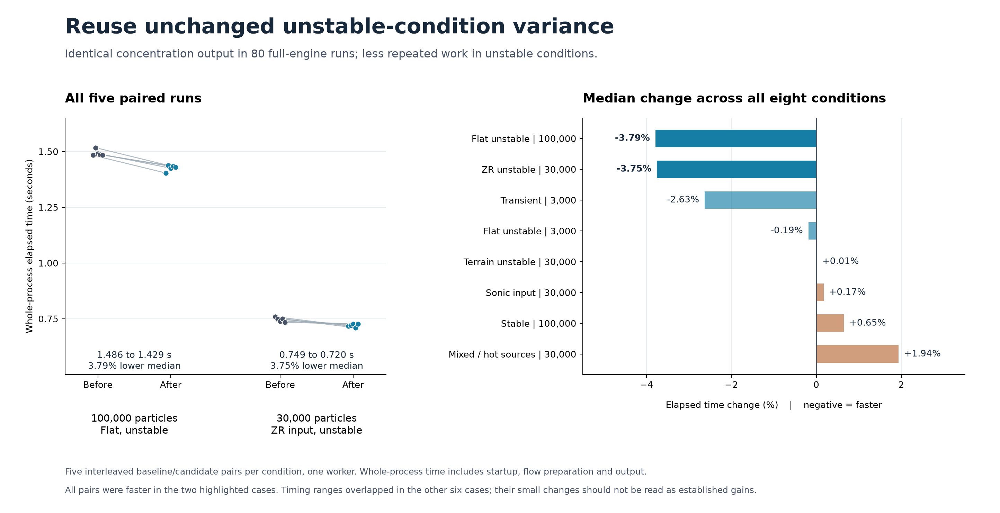

# Reuse unstable vertical-velocity variance

Both particle routines currently evaluate the same power expression at every non-sonic, unstable timestep. Its inputs often stay unchanged while a particle moves through the flow field, so these calls add work without changing the variance. The candidate stores the last Obukhov length, friction velocity and variance in three local floats. It evaluates the original expression again whenever either input changes. The boundary-layer height is already a particle-local value, and the current engine does not change `StdDeviationW` during tracking.

The change touches two source files: 16 added lines and 2 removed lines. The added and removed text totals 1,400 characters, excluding line endings. It is based directly on upstream commit `891225b2f9dbbcda7f5ef6e9ef6db65e64845108` and has no dependency on the other proposed optimizations.

The extracted-expression test passed 102,970 bitwise comparisons, including changing inputs, signed zero, extreme values, NaNs and infinities. The 80 full-engine runs cover eight synthetic conditions, with five interleaved baseline/candidate repetitions per condition. They include flat and prescribed terrain flow, stable and unstable meteorology, mixed sources, hot point sources, sonic and ZR input, and a three-situation transient run. Every concentration payload matched between builds and across repetitions. Source counts, actual particle allocation, normal completion and finite, nonnegative outputs were checked for every run.

In the flat, unstable 100,000-particle case, median elapsed time fell from 1.4858323 to 1.4294843 seconds, a 3.79% reduction. All five paired trials were faster. With ZR input and 30,000 particles, the median fell from 0.7485563 to 0.7204577 seconds (3.75%), again with all five pairs faster. The other six cases had overlapping timing ranges, with median changes between a 2.63% reduction and a 1.94% increase. These are whole-process times, including startup, flow preparation and output. The isolated expression test reduced its measured cost by about 80% when inputs repeated; changing the inputs at every step made that isolated test about 4% slower. The stable and sonic calculation branches retain their original expressions.

The figure reads the recorded JSON and CSV files. Run `render_figure.py` with Matplotlib to regenerate its PNG and SVG versions.

## Reproduce

The scripts use Windows, the .NET 10 SDK and Python with NumPy. Use a known Python executable; set `GRAL_DOTNET` if `dotnet` is not on PATH. In a fresh copy of this directory, run `prepare.py --repository PATH_TO_GRAL_CHECKOUT`, then `run_main.py --cases unstable_small unstable_100k unstable_terrain unstable_hot_mixed stable_100k sonic_30k transient_unstable zr_30k`. The checkout must contain the pinned upstream commit. Preparation checks all source hashes, builds with warnings treated as errors, and runs the compiled expression checks. The Main runner uses a 14-minute suite limit and a 90-second limit for each process.

`results/timings.csv` contains every measured trial; `results/main_summary.json` includes input settings, checks, output hashes and aggregation. `source_manifest.json` records the exact source files. `results/environment.json` is the hardware and SDK snapshot collected earlier on the same test host that day. No model output arrays, checkpoint files or executable binaries are included. The extra signed-zero probe in the compiled fixture documents why a separate zero-gradient shortening candidate was rejected; it is not part of this patch.
