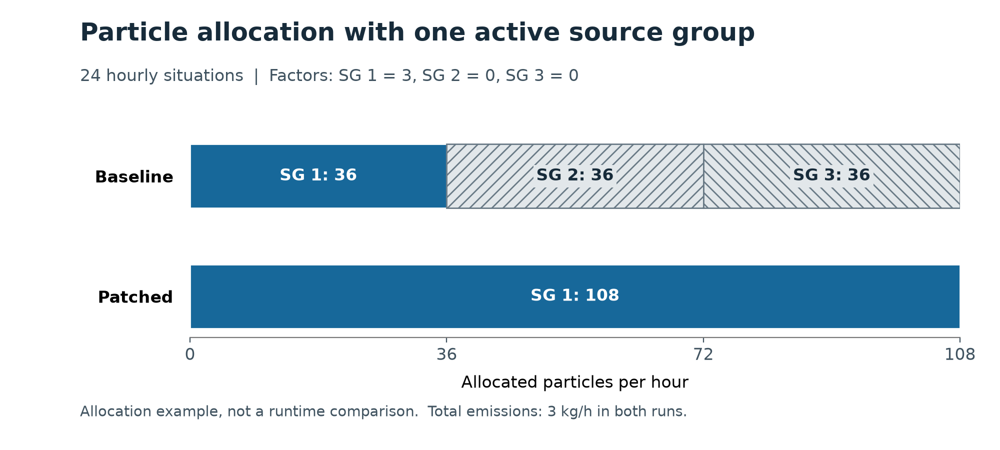

# Active-source allocation: validation and reproduction

This evidence branch contains the test fixtures and figure for the active-source allocation patch. The tested production source is commit `389379c3a46eb296ea8558b488d3d83856b71578`, based on V2701 commit `cd540abf4eda380e5669a891911323351d789e86`. The PR itself changes only `src/Program.cs` and `src/TeilchenAufteilung.cs`.

The 24-hour sparse case has three co-located virtual point sources with equal base rates and hourly factors `(3, 0, 0)`. Its nominal budget is 108 particles per hour. The baseline allocates `36 / 36 / 36`, while the patch allocates `108 / 0 / 0` in every hour. Both runs report 72 kg emitted over 24 hours. The figure shows allocation, not runtime or measured accuracy.



The figure data come from the two complete stdout logs in `logs/`. The baseline writes its static allocation once. The patched model writes a new allocation for every hour. Inactive sources are absent from these allocation blocks and are checked as zero by the test parser. `figures/allocation_data.json` records the input conditions, counts and log hashes.

## Results

| Suite | Cases | Result |
| --- | --- | --- |
| Allocation component | `active`, `off`, `budget`, `deposition`, `deposition-source`, `capacity` | All six passed |
| Transport | `control24`, `sparse24`, `switch48`, `edge4` | All four passed |
| Deposition | `control6`, `late6`, `cold6` | All three passed |
| Baseline comparison | All-active 24-hour control; six-hour deposition control | 72 concentration members, then 18 concentration and 18 deposition members, matched byte for byte |
| Build | .NET 10 Release with `TreatWarningsAsErrors=true` | Zero warnings and errors |

The per-run checks are in `checks/`. Comparisons use the decompressed output members and exclude ZIP timestamps. All fixtures use virtual sources and a fixed seed. The main transport cases use a flat 200 m square domain, a 10 by 10 concentration grid, one worker, `TAUS=3600 s` and `TPS=0.03`. Their total emission rate is 3 kg/h. `edge4` deliberately includes two hours with no active source; the deposition cases also exercise inactive intervals.

## Reproduce

Check out this evidence commit and run the following commands from the repository root. Use the .NET 10 SDK and Python 3. Choose new output directories because the runners refuse to overwrite existing cases.

```sh
dotnet build src/GRAL.csproj -c Release -p:TreatWarningsAsErrors=true
dotnet run --project tests/ActiveSources/ActiveSources.csproj -- active
python tests/ActiveSources/run_synthetic.py --case sparse24 --dll src/bin/Release/net10.0/GRAL.dll --out ./validation-output/sparse24
python tests/ActiveSources/run_deposition.py --case control6 --dll src/bin/Release/net10.0/GRAL.dll --out ./validation-output/control6
```

Repeat the component command with each case in the table. For transport, replace `sparse24` and its output path with `control24`, `switch48` or `edge4`. For deposition, replace the case name and output path with `late6` or `cold6`. Use the Python 3 launcher available on your system (`python`, `python3` or `py -3`). These model checks require only Python's standard library.

The baseline control comparisons use a separate build of the base commit above. The transport and deposition runners accept `--baseline` only for `control24` and `control6`, respectively.

To redraw the figure, install Matplotlib in the chosen Python environment and run:

```sh
python validation/active-source-allocation-20261102/figures/render_figure.py --baseline-log validation/active-source-allocation-20261102/logs/baseline_sparse24.txt --patched-log validation/active-source-allocation-20261102/logs/patched_sparse24.txt --out ./validation-output/figure
```

The script validates the allocation blocks and emission totals before producing PNG, SVG, CSV and JSON files.

## Interpretation

The allocation checks cover all four source types. Full model runs here use point sources. Redistribution can change individual Monte Carlo results, and source-weighted deposition averages can differ by floating-point rounding from particle-level summation. These fixtures do not establish production-domain equivalence, a runtime gain or a reduction in statistical error.
