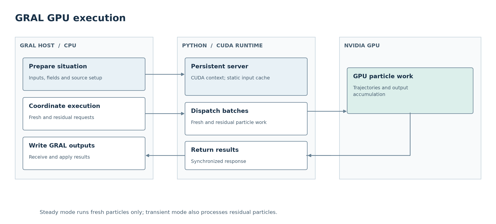
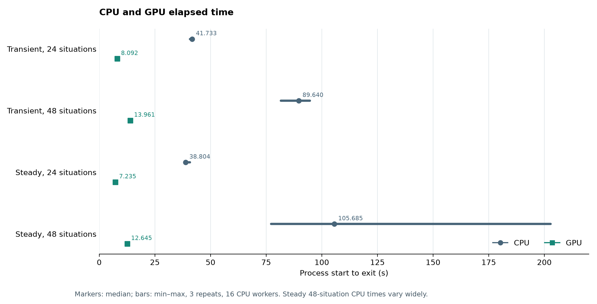

# GRAL GPU PR explanation and figures

These figures support the description of [GRAL PR #77](https://github.com/GralDispersionModel/GRAL/pull/77) at source commit [`b606731`](https://github.com/Borealis-Thoon/GRAL/commit/b60673164b749896c3b942d0e89753addc1c6f7b). This revision changes the presentation of the existing evidence. It contains no new model measurements or production source changes.

The execution diagram shows the responsibilities of the GRAL host, persistent Python/CUDA runtime and GPU. It represents the published source, whose eligibility guards still apply.

The timing figure uses the existing transient and steady analysis summaries from evidence revision [`510aaabc`](https://github.com/Borealis-Thoon/GRAL/tree/510aaabc2207ec5f0c6c92b6ca4a6af6878809ae/validation/gpu-all-sources-20261102/analysis/measured). Markers show medians and bars show the minimum and maximum of three repeats, including process startup. The steady 48-situation CPU sample has substantial variability. Steady situations are separate meteorological calculations; transient situations represent consecutive hourly intervals.

PNG, SVG and PDF copies are included with `build_current_pr_figures.py`. The Python and general review records describe the numerical and visual checks. The underlying measurements, full timing tables, numerical comparisons and limitations remain in the linked evidence revision.
