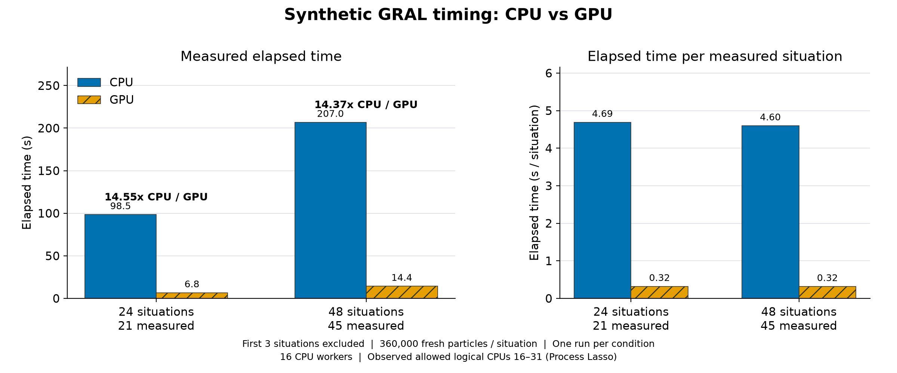

# GPU validation support

This directory contains validation tools, a synthetic fixture, and the recorded CPU/GPU comparison for the [experimental GPU source change](https://github.com/Borealis-Thoon/GRAL/tree/7bec798bae7dd2a823cfe3031cc1a811ea6a965a). Apply the source change in a separate GRAL checkout. Copy the contents of `overlay/` into that checkout to add the tests and C#-to-CUDA translator.

The proposed production source omits the benchmark observer. To reproduce the recorded measurements, apply `patches/instrumentation.patch` in a separate validation checkout. It restores `BenchmarkTelemetry.cs` and four observer blocks in `Program.cs`, which were present during measurement.

The tested runtime is Windows x64 with Python 3.12.14, .NET SDK 10.0.401, an NVIDIA driver, and NVRTC 12.9. The Python runtime uses the standard library. The translator uses Roslyn from the installed .NET SDK. CUDA compilation targets `compute_120` with `--std=c++11` and `--fmad=false`. The measured GPU was an NVIDIA GeForce RTX 5080 with driver 617.42. The current GPU path is experimental, and GUI launch is unsupported. Its supported fixture uses flat synthetic area sources, transient mode, fixed seeds, and no deposition. The runtime guards reject unsupported configurations.

1. Prepare a source checkout with the companion GPU change and a second checkout of this validation branch. From the source checkout root, set `$support` to this directory. The example assumes the second checkout is a sibling named `GRAL-validation`.

```powershell
$sourceRoot = (Get-Location).Path
$support = (Resolve-Path ../GRAL-validation/validation/gpu-v2701-20261102).Path
Copy-Item (Join-Path $support 'overlay/gpu/*') ./gpu -Recurse -Force
New-Item -ItemType Directory -Path ./tests -Force | Out-Null
Copy-Item (Join-Path $support 'overlay/tests/*') ./tests -Recurse -Force
$env:HOST_TEST_PYTHON = (Get-Command python -ErrorAction Stop).Source
& $env:HOST_TEST_PYTHON --version
dotnet --version
```

Verify that the selected interpreter is Python 3.12 and that the SDK meets `metadata/dependencies.json`. On Windows, a Store alias can appear as `python`; select an installed Python executable if that command does not report its version.

2. Run the CPU tests from the source checkout root. They require no CUDA context.

```powershell
dotnet build src/GRAL.csproj -c Release -warnaserror
if ($LASTEXITCODE -ne 0) { throw 'GRAL build failed' }
dotnet run --project gpu/tests/host_tests/HostContracts.csproj -c Release
if ($LASTEXITCODE -ne 0) { throw 'Host contracts failed' }
& $env:HOST_TEST_PYTHON -B -m unittest discover -s gpu/tests/translator_tests -p 'test_*contract.py' -v
if ($LASTEXITCODE -ne 0) { throw 'Python contracts failed' }
dotnet run --project gpu/tests/source_group_tests/SourceGroupTests.csproj -c Release
if ($LASTEXITCODE -ne 0) { throw 'Source-group tests failed' }
foreach ($mode in @('active', 'off', 'budget', 'deposition', 'deposition-source', 'capacity')) {
    dotnet run --project tests/ActiveSources/ActiveSources.csproj -c Release -- $mode
    if ($LASTEXITCODE -ne 0) { throw "ActiveSources $mode failed" }
}
& $env:HOST_TEST_PYTHON -B gpu/tests/rng_endpoint_tests/verify_rng_endpoint.py --report "$env:TEMP/gral-rng-cpu.json"
if ($LASTEXITCODE -ne 0) { throw 'RNG endpoint tests failed' }
```

The host tests exercise the binary protocol, caching, result handling, and failure paths. The Python suite checks runtime, PTX cache, dispatch, and launch-status contracts. Source-group tests cover the supported group range, while `ActiveSources` covers allocation and deposition guards. `gpu/tests/host_tests/prepare_cpu_trace.py` can create an additional temporary CPU trace build with `--target` and `--report`; use a new target directory.

3. Regenerate the CUDA source from the C# source when reviewing the translator. The command replaces the generated kernel and field manifest in this validation checkout.

```powershell
dotnet run --project gpu/translator/Transpile.csproj -c Release -- src gpu/runtime
if ($LASTEXITCODE -ne 0) { throw 'Translation failed' }
```

The translator also writes `gpu/runtime/translation_manifest.json` with local source locations. Keep that generated manifest local. The public measurement provenance in `metadata/measured_translation_source_provenance.json` uses relative paths and normalized text hashes. `records/runs.json` preserves the raw source, runtime, and build hashes recorded for the instrumented benchmark. These hash records have different normalization rules, as stated in `metadata/content_scope.json`.

4. For a GPU run, supply an NVRTC 12.9 DLL directory through `INU_GPU_NVRTC_DIR`. It must contain `nvrtc64_120_0.dll` and the matching NVRTC builtins DLL. The example uses a local `nvrtc-dlls` directory that you populate from your NVRTC installation. NVIDIA binaries and compiled PTX are external dependencies.

```powershell
$env:INU_GPU_NVRTC_DIR = (Resolve-Path ./nvrtc-dlls).Path
$runRoot = Join-Path $sourceRoot ('validation-runs/' + [guid]::NewGuid().ToString('N'))
New-Item -ItemType Directory -Path $runRoot | Out-Null
Copy-Item (Join-Path $support 'fixture/synthetic72_360k/*') $runRoot -Recurse
$env:INU_GPU_EXPERIMENTAL = '1'
$env:INU_GPU_PYTHON = $env:HOST_TEST_PYTHON
$env:INU_GPU_SERVER = Join-Path $sourceRoot 'gpu/runtime/server.py'
$env:INU_GPU_MANIFEST = Join-Path $sourceRoot 'gpu/runtime/fields_manifest.json'
$env:INU_GPU_METRICS = Join-Path $runRoot 'gpu_metrics.jsonl'
$env:INU_GPU_STDERR = Join-Path $runRoot 'gpu_server.stderr'
$env:INU_GRAL_GPU_CHUNK = '65536'
$env:INU_GRAL_GPU_BLOCK = '128'
$env:INU_GPU_CACHE_COORDINATES = '0'
$env:INU_GPU_CACHE_DIR = Join-Path $sourceRoot 'validation-ptx-cache'
$gral = Join-Path $sourceRoot 'src/bin/Release/net10.0/GRAL.dll'
Push-Location (Join-Path $runRoot 'Computation')
try {
    dotnet $gral (Get-Location).Path 'SITUATIONS:1:24'
    if ($LASTEXITCODE -ne 0) { throw 'GPU fixture run failed' }
} finally { Pop-Location }
```

Set `INU_GPU_EXPERIMENTAL=0` for a CPU run and copy the fixture into a new run directory. Use `SITUATIONS:1:48` for the 48-situation case. Keep the `Computation` directory as the process working directory: the portable `windfeld.txt` resolves `../Weather` from there. Only that file differs from the measured fixture. `fixture/contract.json` lists the measured hashes and the portable hashes separately. All 11 other inputs are byte-identical to the measured inputs.

The first cached GPU run can compile the kernel and populate the PTX cache. The recorded measurements used cache hits. Check the cache status in the GPU metrics when comparing startup or whole-process times. A GPU failure stops the run; the implementation has no fallback after partial GPU execution.

The optional CUDA endpoint tests below require the same driver and NVRTC dependencies. They supplement the CPU tests. The recorded 24/48-situation benchmark executed the full GPU model; the CUDA endpoint unit tests were not executed for that benchmark record.

```powershell
& $env:HOST_TEST_PYTHON -B gpu/tests/translator_tests/verify_cuda_contract.py --report "$env:TEMP/gral-cuda-contract.json" --nvrtc-log "$env:TEMP/gral-nvrtc.log"
if ($LASTEXITCODE -ne 0) { throw 'CUDA contracts failed' }
& $env:HOST_TEST_PYTHON -B gpu/tests/translator_tests/test_generated_nonfinite.py --report "$env:TEMP/gral-nonfinite.json"
if ($LASTEXITCODE -ne 0) { throw 'Nonfinite guard tests failed' }
& $env:HOST_TEST_PYTHON -B gpu/tests/translator_tests/test_timestep_guard.py --report "$env:TEMP/gral-timestep.json" --check-anchors
if ($LASTEXITCODE -ne 0) { throw 'Timestep guard tests failed' }
& $env:HOST_TEST_PYTHON -B gpu/tests/rng_endpoint_tests/verify_rng_endpoint.py --report "$env:TEMP/gral-rng-cuda.json" --cuda
if ($LASTEXITCODE -ne 0) { throw 'CUDA RNG endpoint tests failed' }
```

5. To reproduce the instrumented measurement, apply the observer patch before building. The timing observer requires a new absolute JSONL path, exactly three warmup situations, and an explicit end of 24 or 48. Run its contract tests after applying the patch.

```powershell
git apply --check (Join-Path $support 'patches/instrumentation.patch')
if ($LASTEXITCODE -ne 0) { throw 'Observer patch does not apply' }
git apply (Join-Path $support 'patches/instrumentation.patch')
if ($LASTEXITCODE -ne 0) { throw 'Observer patch failed' }
dotnet run --project gpu/tests/benchmark_timing_tests/BenchmarkTimingTests.csproj -c Release
if ($LASTEXITCODE -ne 0) { throw 'Timing observer tests failed' }
dotnet build src/GRAL.csproj -c Release -warnaserror
if ($LASTEXITCODE -ne 0) { throw 'Instrumented build failed' }
```

Before launching each fresh fixture copy, set the following variables. Set the end to match the explicit situation range supplied to GRAL.

```powershell
$env:INU_BENCH_TIMING = Join-Path $runRoot 'timing.jsonl'
$env:INU_BENCH_WARMUP = '3'
$env:INU_BENCH_END = '24'
```

For the recorded runs, Process Lasso allowed logical CPUs 16 through 31 on a 32-logical-CPU host. Both modes used 16 CPU workers, as set in `Max_Proc.txt`. The runtime used its default tiering policy with `tieredCompilation=true`; the harness removed inherited compilation overrides and startup hooks. The harness also checked background load before each launch. Its original process-control scripts are machine-specific, so this bundle provides the inputs, observer, raw timing events, numeric records, and commands needed to inspect or reproduce the measurement on another host. Hardware, affinity, background load, and cache state can change the result.

Each situation represents one model hour and allocates 360,000 fresh particles. The measured interval begins after situation 3 and ends after situation 24 or 48. At both boundaries the observer drains pending output before taking the stopwatch timestamp. Intermediate situations retain their usual output overlap. This interval includes model work, host/device communication, result application, and output completion within those boundaries. GPU kernel time is a separate device metric. `whole_wall_s` in `records/timing.csv` covers the model child process from launch to exit, including startup and the first three situations; it excludes the harness quiet-load gate.

The four rows below are single runs. CPU/GPU speedup is CPU elapsed time divided by GPU elapsed time over the measured interval.

| Requested situations | Measured situations | CPU elapsed, s | GPU elapsed, s | CPU/GPU speedup | All-hour NMAE, % |
| --- | --- | --- | --- | --- | --- |
| 24 | 21 | 98.5178539 | 6.7715543 | 14.54878 | 0.0011369308 |
| 48 | 45 | 206.951839 | 14.3966516 | 14.374998 | 0.0010635147 |



The weighted NMAE is `100 * sum(abs(GPU - CPU)) / sum(abs(CPU))`, aggregated across matched hourly concentration fields. Numeric comparisons cover all 24 or 48 hours, including warmup. `records/cpu_gpu24.json` and `records/cpu_gpu48.json` retain per-situation and source-group details, output hashes, measured-hour metrics, and support comparisons. Within each mode, the decoded concentration members in the 24-hour prefix match those of the 48-hour run. CPU and GPU concentration values have small nonzero differences. A scientific acceptance threshold was not assigned, and one repetition provides no estimate of timing variability.

`MANIFEST_SHA256.json` identifies every public file. `metadata/environment.json` records the measured hardware and software inventory. The fixture and records contain synthetic inputs and numeric validation evidence. The bundle excludes research inputs, AIS, private deployment directories, machine-specific full paths, process identifiers, compiled model binaries, NVRTC binaries, and PTX cache contents.
