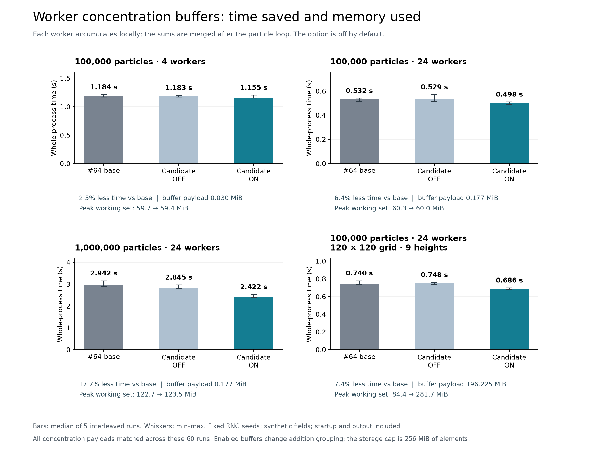

# Optional worker concentration buffers

New-particle contributions currently lock a shared `Conz3dDouble` cell before adding to it. When several workers visit the same cell, those additions compete for the same lock. This patch lets each queued worker accumulate into its own double buffer, then adds the worker sums to the existing concentration field after the particle loop. Residual-particle contributions already in that field are retained.

The option is off by default. Set `GRAL_WORKER_CONCENTRATION_MB` to a positive integer to enable it and choose a buffer budget in MiB. Values above 256 are capped at 256; an unset, invalid or nonpositive value keeps the shared path. The option applies to the fixed-seed particle driver with at least two workers. One worker, the other driver, no allocated groups, an exceeded budget or growth beyond the first allocation uses the shared path. Each enabled or fallback decision is logged.

```powershell
$env:GRAL_WORKER_CONCENTRATION_MB = "256"
dotnet GRAL.dll <input-directory>
```

Storage is allocated only for selected groups with allocated source particles. These are allocation flags, not a current-hour emission switch. The first allocation is reused. The cap covers double-array element storage; the process also needs memory for array metadata and the rest of the model.

## Measured tradeoff



The table reports medians of five interleaved cold-process runs per mode. The first three cases use two colocated point sources; the last uses eight area sources on a 120 × 120 concentration grid with nine output heights. All runs use synthetic inputs and fixed RNG seeds. Wall time includes startup, input and output. Peak working set is the largest observed OS-maintained peak across the five runs.

| Synthetic case | #64 base (s) | Default off (s) | Enabled (s) | Buffer payload (MiB) | Peak working set, base / enabled (MiB) |
|---|---:|---:|---:|---:|---:|
| 100,000 particles, 4 workers | 1.184 | 1.183 | 1.155 | 0.030 | 59.7 / 59.4 |
| 100,000 particles, 24 workers | 0.532 | 0.529 | 0.498 | 0.177 | 60.3 / 60.0 |
| 1,000,000 particles, 24 workers | 2.942 | 2.845 | 2.422 | 0.177 | 122.7 / 123.5 |
| 100,000 particles, 9 slices, 24 workers | 0.740 | 0.748 | 0.686 | 196.225 | 84.4 / 281.7 |

The million-particle case fell from 2.942 to 2.422 seconds, a 17.7% reduction against the #64 base. The enabled mode was 14.9% faster than the same candidate with buffers disabled. The 100,000-particle, four-worker case showed a much smaller change, with overlapping timing ranges. The dense-grid case used about 196 MiB of buffer payload for a 7.4% reduction in median time, which makes the memory cost relevant when deciding whether to enable it.

Enabling buffers changes double-addition grouping. All concentration outputs and their repetitions in the 60-run performance suite were byte-identical. This result is specific to these fixtures and does not establish bitwise reproducibility for every parallel run.

## Validation

The final source passed six warning-as-error builds, 2,511 component assertions over five settings, 27 driver probes, and 186 actual Main runs: 14 conditions with three repeats per mode, plus four performance conditions with five repeats per mode. The conditions cover one, four and 24 workers, all four source types, variable emissions, an inactive large source, unused selected groups, nine output heights, budget fallback, decay, odour and terrain.

Component checks cover compact source-group mapping, retained residual sums, exact particle visit coverage, buffer reuse and clearing, capacity growth followed by a smaller mapping, and fallback paths. An adversarial check found that an inactive particle could hold an unrelated source-group byte. The final code checks the existing `ParticleSource == 0` return before looking up a buffer slot. A fixture with selected groups 1 and 2 and an inactive particle marked as group 255 fails on the earlier candidate and passes on the final source.

In the small-field suite, concentration differences appeared only in the 24-worker budget-fallback case. The largest relative L1 difference was about 1.32e-9, matching the scale of the base's own repeats. Odour side fields retain their existing shared float accumulation and also vary across parallel repeats; `results/odour.json` reports those fields separately. Every checked concentration and odour value was finite and nonnegative.

## Source and reproduction

The base is `891225b2f9dbbcda7f5ef6e9ef6db65e64845108` plus the double-accumulation change from #64 (`003b00e60ebe9f0c5acc7377ed155c3271b4d8c9`). `worker_accumulation.patch` contains only the new four-file change: 169 added and four removed lines. Changed full-line contents total 8,006 characters, excluding diff signs, line endings. The prerequisite patch is supplied separately.

Use Python with NumPy, Git, and the .NET 10 SDK on Windows. Redrawing the figure also requires Matplotlib; run `python render_figure.py` from this bundle. `DOTNET_EXE` can select a different installed dotnet executable. The supplied repository must contain the base commit; the preparation script only reads it. Choose a new, empty work-directory path.

```powershell
python prepare.py --source-repo <GRAL-checkout> --work-dir <new-work-directory>
python <new-work-directory>/run_component.py
python <new-work-directory>/run_main.py
python <new-work-directory>/run_performance.py
python audit_odour.py --run-dir <new-work-directory>/main --output <new-work-directory>/odour.json
```

Preparation verifies all 171 source files against `source_manifest.json`, using UTF-8 text without BOM and LF line endings. The component runner uses separate diagnostic source copies for driver coverage. Main timings use the uninstrumented engine builds. The Main runners save raw outputs locally; this bundle contains source patches, synthetic-input recipes, measurements and verification records.

## Evidence files

- `results/main.json`, `results/performance.json`: complete final run records, output payload hashes and comparisons.
- `results/runs.csv`, `results/summaries.csv`: timing, actual particle counts and memory measurements.
- `results/paired_comparisons.csv`, `results/repeat_differences.csv`: concentration changes and the parallel repeat reference.
- `results/component.json`, `results/inactive_particle_regression.json`: component and regression checks.
- `results/odour.json`: checks of all four odour side fields.
- `results/environment.json`: CPU, memory snapshot and runtime version.
- `source_manifest.json`: source provenance and normalized hashes.
